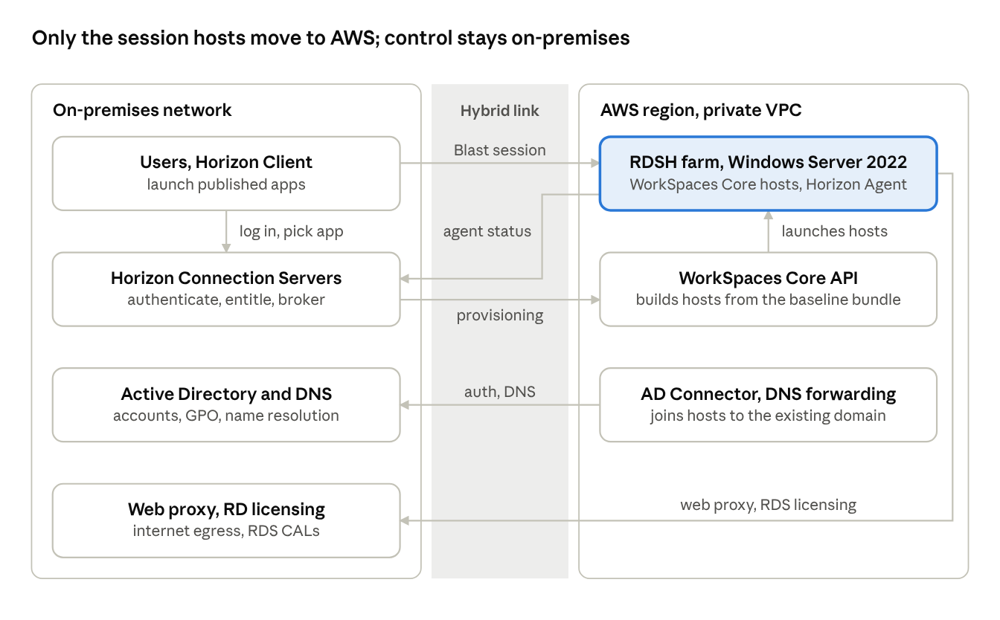

# Extending Omnissa Horizon Published Apps to AWS with WorkSpaces Core: High-Level Design

As of 10 Nov 2026

## Design summary

Keep the existing on-premises Horizon 8 pod as the single control plane and add Amazon WorkSpaces Core as a second capacity location for RDSH hosts. Users, entitlements, AD, DNS and the web proxy stay where they are; only the Windows Server 2022 session hosts move to AWS.

This works because Horizon 8 2412 and later let a Connection Server that runs on-premises use WorkSpaces Core capacity, and support Windows Server 2019/2022 multi-session hosts, manual farms and published applications there. The seven-step publishing workflow carries over almost unchanged: the infrastructure team provisions WorkSpaces Core instances instead of vSphere VMs, and every other step keeps its owner.

Three things are new and need owners: a private hybrid link to an AWS VPC, a WorkSpaces directory registration (AD Connector to the existing AD), and an AWS-side baseline image (bundle) equivalent to the approved Windows Server 2022 build.

## Architecture at a glance

Users log in to the on-premises Connection Server as today, and the Blast session then runs straight to a session host in AWS over the Direct Connect or VPN link. The hosts depend on on-premises AD, DNS, web proxy and RD licensing for every logon.

## Key design decisions

| Decision | Recommendation | Why | Alternative |
| --- | --- | --- | --- |
| Pod topology | Extend the existing on-premises pod; register WorkSpaces Core as a capacity provider | One console, one set of entitlements, no new Horizon servers. Supported from Horizon 8 2412 | A second pod on EC2 joined by Cloud Pod Architecture, if AWS must keep serving users when the on-premises site is down |
| Farm type | One manual farm per application, built from individually provisioned hosts | Matches today's process: the SME installs on every server over RDP | Bundle-based farm: the SME installs once on a gold host, the infrastructure team captures a bundle and Horizon builds the farm from it (automated RDS farms from 2506) |
| Baseline image | Custom WorkSpaces bundle built from the AWS public Windows Server 2022 BYOP bundle plus the org baseline components and agents | No image import; fastest route to an approved build | Import the existing on-premises baseline through VM Import as a BYOL image |
| Identity | AD Connector in the VPC pointing at the on-premises AD; hosts join the existing domain | Same accounts, GPOs and entitlement groups. Simple AD is not supported | Add domain controllers on EC2 in the same VPC to remove the logon dependency on the hybrid link |
| Display protocol | Blast Extreme | The only protocol supported on WorkSpaces Core farms | None |
| User traffic path | On-premises users connect to the Connection Server, then directly to the RDSH host over the hybrid link | Users are internal, so no Unified Access Gateway is needed for this phase | UAG pair in a public subnet if external access is added later |
| Running mode | AlwaysOn for RDSH hosts | Session hosts must be up for brokering and for SME installs | Hourly (manual) running mode for test or low-use farms |

The farm-type choice deserves a proof of concept. Omnissa's current WorkSpaces Core procedure prepares one host, captures it as a bundle and selects that bundle in the Add Farm wizard, so per-server installs may mean more manual work than on vSphere. The bundle-based model also removes the risk of application drift between hosts.

## Components and placement

| Component | Location | Status | Role in this design |
| --- | --- | --- | --- |
| Users and Horizon Client | On-premises | Existing | Launch published apps with their AD account |
| Horizon Connection Servers | On-premises | Existing, upgrade to 2412 or later if older | Authenticate, entitle, broker; call the WorkSpaces API through the capacity provider |
| Active Directory and DNS | On-premises | Existing | Domain join, authentication, GPO, name resolution for AWS hosts |
| Web proxy | On-premises | Existing | Internet egress for AWS session hosts, reached over the hybrid link |
| RD licensing server | On-premises | Existing, confirm capacity | Issues RDS CALs to the AWS session hosts |
| Direct Connect or site-to-site VPN | Between sites | New | Private path for brokering, Blast sessions, AD, DNS, proxy and RDP |
| VPC with two private subnets in two Availability Zones | AWS | New | Hosts the RDSH instances and the AD Connector |
| AD Connector, registered as a WorkSpaces directory | AWS | New | Lets WorkSpaces Core join instances to the existing domain; must use shared tenancy for public Windows Server bundles |
| Route 53 Resolver outbound endpoint | AWS | New | Forwards the AD DNS zones from the VPC to on-premises DNS |
| WorkSpaces Core capacity provider and IAM user | AWS and Horizon Console | New | Connection Server credentials for the WorkSpaces API in one region |
| Baseline bundle (Windows Server 2022 Standard) | AWS | New | Org-approved image with RDS role, baseline components, agents and Horizon Agent |
| RDSH farms on WorkSpaces Core instances | AWS | New | Run the published applications |

## Network and connectivity

Every flow between the two sites rides the private hybrid link, so its capacity and resilience set the user experience. Direct Connect with a VPN backup is the target; a site-to-site VPN alone is enough for a pilot. Omnissa requires under 120 ms latency between Connection Server and Horizon Agent.

| Flow | From | To | Port (confirm against the Omnissa ports guide) |
| --- | --- | --- | --- |
| Brokering and login | Horizon Client | Connection Server | TCP 443 (unchanged, stays on-premises) |
| Blast session | Horizon Client | RDSH host in AWS | TCP and UDP 22443 |
| Agent registration and status | RDSH host in AWS | Connection Server | TCP 4002 |
| Provisioning API | Connection Server | WorkSpaces regional endpoints | TCP 443 outbound, through the proxy or directly |
| Domain join and authentication | RDSH hosts, AD Connector | Domain controllers | Standard AD ports (DNS, Kerberos, LDAP, SMB, RPC) |
| Name resolution | VPC resolver | On-premises DNS | TCP and UDP 53 through the Resolver outbound endpoint |
| RDS licensing | RDSH host in AWS | RD licensing server | TCP 135 and RPC dynamic ports |
| Internet egress | RDSH host in AWS | On-premises web proxy | Proxy port, set by GPO as today |
| Admin and SME access | Admin and SME workstations | RDSH host in AWS | TCP 3389, limited to named AD groups and source subnets |

- **Addressing:** give the VPC a CIDR that does not overlap any on-premises range and size the two host subnets for peak farm growth.
- **Security groups:** one group for RDSH hosts that allows only the flows above from on-premises ranges; no inbound from the internet.
- **Session bandwidth:** Blast traffic now crosses the hybrid link in both directions, so size the link for peak concurrent sessions, not just management traffic.
- **Application back ends:** an app that talks to an on-premises database or file share will make that call across the link too. Check latency per application before placing it in AWS.

## Workflow mapping

Five of the seven steps do not change at all; steps 3 and 4 change only in what the infrastructure team does behind the request.

| # | Today (on-premises) | In AWS | Change |
| --- | --- | --- | --- |
| 1 | SME determines the number of servers per application | Same process, plus a WorkSpaces bundle hardware type (vCPU and memory) per server | Sizing input adds a bundle type |
| 2 | SME asks the infrastructure team to provision servers | Same request, with target location AWS | Request form gains a location field |
| 3 | Infrastructure team provisions Windows 2022 servers from the approved baseline image | Infrastructure team launches the requested number of WorkSpaces Core instances from the approved baseline bundle; each joins the existing AD domain through the AD Connector into a dedicated OU | Different tooling (WorkSpaces console, CLI or pipeline) instead of vSphere |
| 4 | Infrastructure team adds servers to the Horizon farm and gives the SME RDP access | Hosts register with the on-premises Connection Server through the Horizon Agent; the team creates a manual farm for the application and adds the SME's AD group to the RDP access group | Same Horizon Console, new farm on AWS hosts |
| 5 | SME installs the application and components | Same, over RDP across the hybrid link, on every host and in the same path on each | None |
| 6 | SME asks the infrastructure team to publish the app | Infrastructure team creates the application pool on the AWS farm and entitles the AD group | None |
| 7 | Users launch the published app with their AD account | Same client, same Connection Server URL, same login; the session lands on a host in AWS | None for users |

One-time setup comes before the first request: the hybrid link, VPC, AD Connector and directory registration, DNS forwarding, the IAM user and capacity provider, and the baseline bundle.

To move an existing application rather than add a new one, build the AWS farm alongside the on-premises farm, test with a pilot entitlement group, then switch the application pool's entitlement to the AWS farm.

## Licensing, security and operations

- **Horizon version and license:** Connection Servers need Horizon 8 2412 or later for on-premises pods to use WorkSpaces Core; 2506 or later adds automated RDS farms. Confirm the current Horizon license covers WorkSpaces Core capacity.
- **Microsoft licensing:** the AWS Windows Server bundles do not include RDS access licenses. Bring RDS CALs or SALs and point the hosts at an RD licensing server. The AWS account must be enabled for BYOL.
- **Supported OS:** Windows Server 2019 Standard and 2022 Standard only, which fits the current Windows Server 2022 baseline.
- **API credentials:** an on-premises Connection Server authenticates with an IAM user's access keys, not an instance role. The user needs the AWS managed policies AmazonWorkSpacesAdmin, AmazonSSMDirectoryServiceAccess and AmazonSSMManagedInstanceCore, plus an inline allow for workspaces:DescribeWorkspaceImages. Treat the keys as a privileged secret: dedicated user, no console access, scheduled rotation.
- **Encryption and audit:** encrypt instance volumes with a customer managed KMS key, and log WorkSpaces API activity in CloudTrail.
- **Baseline upkeep:** the AWS bundle is a second copy of the approved build. Patch and re-capture it on the same cadence as the on-premises image, and keep the Horizon Agent version aligned with the Connection Servers.
- **Monitoring:** farm health and sessions stay in Horizon Console. Add CloudWatch alarms for the hybrid link and AD Connector status, since either failing stops new logons.
- **Cost control:** AlwaysOn hosts bill monthly regardless of use. Tag instances by application for chargeback, and remove hosts when a farm shrinks.
- **Resilience:** spread each farm's hosts across both Availability Zones. The on-premises Connection Servers, AD and the hybrid link remain single points of dependency in this phase.

## Assumptions and open questions

Assumptions made in this design:

- All users are on the on-premises network, so no external access path is designed.
- The existing pod runs Horizon 8, not Horizon Cloud, and can be upgraded to 2412 or later.
- The existing AD domain, RD licensing server and web proxy can serve hosts in AWS.

Open questions to close before detailed design:

- [ ] Which Horizon 8 version are the Connection Servers on today?
- [ ] Which AWS region, and is it under 120 ms from the on-premises site?
- [ ] Is there a Direct Connect or VPN to AWS already, and what bandwidth is free for session traffic?
- [ ] Per-server installs or a gold-image bundle per application? Confirm in a proof of concept how the current release builds WorkSpaces Core farms.
- [ ] Does the Microsoft agreement allow the existing RDS CALs to be used on AWS (License Mobility), or are SALs needed?
- [ ] Should domain controllers be added in AWS so logons survive a hybrid link outage?
- [ ] Is a single on-premises control plane acceptable, or is a second pod in AWS needed for site resilience?
- [ ] Which applications go first, and where do their back-end databases and file shares live?

## Sources

- [Amazon WorkSpaces Core: Creating and Preparing RDS Hosts for Horizon 8 Manual Farms](https://docs.omnissa.com/Desktops-and-Applications-in-Horizon-V2512/AmazonWSCore-CreatingForManualFarms) (Omnissa docs, 2512): Connection Server placement, IAM policies, directory rules, supported OS, bundle procedure.
- [Deploying Omnissa Horizon with Amazon EC2 and Amazon WorkSpaces](https://techzone.omnissa.com/resource/deploying-omnissa-horizon-amazon-ec2-and-amazon-workspaces) (Omnissa Tech Zone): deployment options, feature matrix, latency limit, registered machines.
- [Omnissa and Amazon announcements, re:Invent 2024](https://www.omnissa.com/insights/omnissa-amazon-announcements-reinvent-2024/) (Omnissa): pods outside AWS, Windows Server BYOP bundles, manual farms and published apps in 2412.
- [Horizon 8 2506 release notes](https://docs.omnissa.com/horizon8-rn-V2506-testing/Horizon8-ReleaseNotes) (Omnissa docs): automated RDS farms on WorkSpaces Core.
- [Multi-session Windows Server on WorkSpaces Core](https://www.repost.aws/articles/ARs6o4ZnAXToylZsN3or4ObA/unlock-multi-session-capabilities-for-your-byop-vdi-solution-and-amazon-workspaces-core-using-windows-server-os) (AWS re:Post): RDS CAL/SAL requirement, BYOL account enablement.

Port numbers in the network table are the standard Horizon defaults from general product knowledge, not from the pages above; confirm them against the Omnissa ports guide for the installed version.
