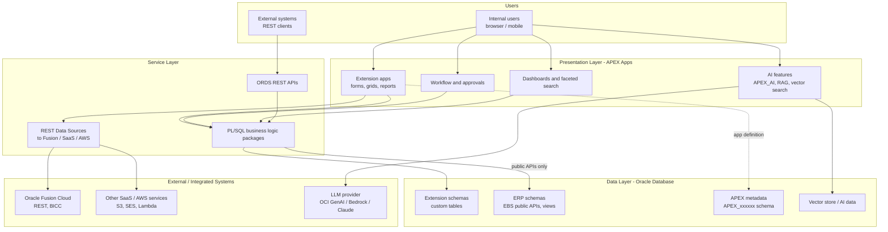
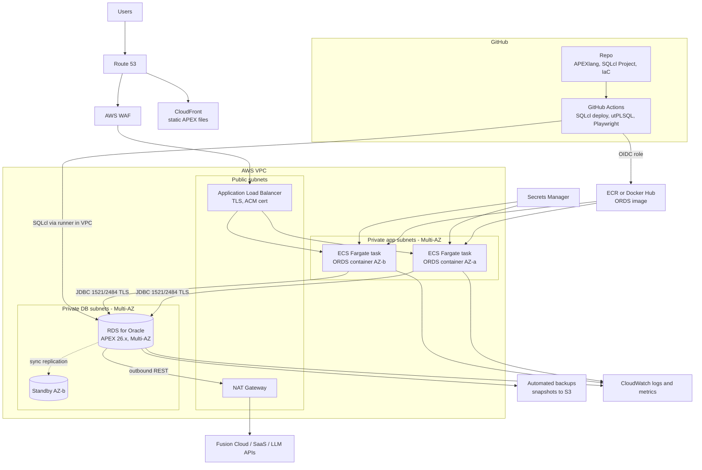
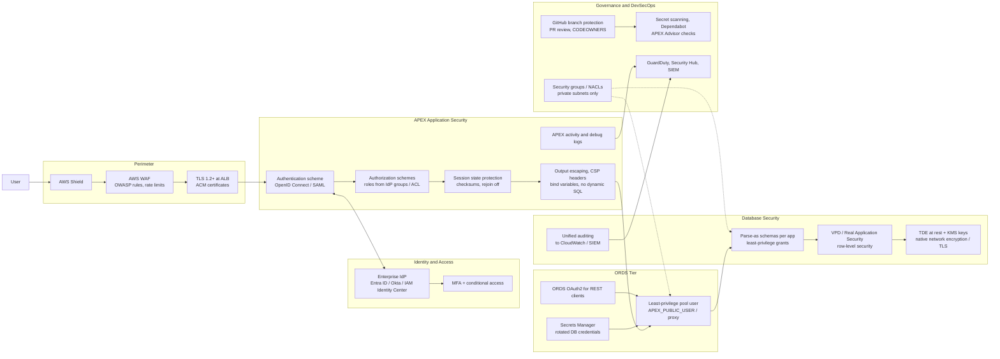

# Oracle APEX as a Customization Platform — Assessment

*Prepared October 2026. Current GA release: APEX 26.1 (patch 26.1.5), with 26.2 announced.*

## 1. Summary

Oracle APEX is a mature, low-code platform that runs **inside the Oracle Database**. As a customization/extension layer for Oracle-centric estates (E-Business Suite, Fusion Cloud, custom Oracle schemas) it is fast, cheap and secure. Its weaknesses are portability, DevOps maturity and talent pool. The 2026 releases (APEXlang, SQLcl Projects, AI App Generator) materially narrow the DevOps gap.

**Verdict:** Continue building on APEX for *data-centric, Oracle-adjacent* extensions — but do so behind clear guardrails (API-first, thin business logic in the app, Git-as-source-of-truth, CI/CD) so the investment stays portable and you avoid building a second, unmanaged ERP.

---

## 2. Strengths

| Area | Strength |
|---|---|
| Speed | Forms, interactive reports/grids, faceted search, charts, maps, workflow and approvals out of the box. Weeks, not months. |
| Data proximity | Logic runs where the data lives (SQL/PL/SQL). No ORM, no middle-tier round trips; excellent for reporting and CRUD-heavy apps. |
| Cost | No separate licence — included with any licensed Oracle Database (EE or SE2). Runtime is only ORDS + the DB. |
| Security baseline | Session state protection, built-in XSS/SQLi escaping, authorization schemes, VPD/RAS integration, CSP support. |
| Oracle integration | Native fit for EBS (same DB), Fusion Cloud (REST data sources, Fusion-styled Redwood theme), ORDS REST APIs. |
| Scale | Stateless engine; scales with the database (RAC, Autonomous autoscaling). Thousands of concurrent users is routine. |
| AI | `APEX_AI` API, RAG data sources, vector search (23ai/26ai), AI Assistant; APEX 26.x adds the AI Application Generator. |
| Longevity | 20+ years, regular releases, used internally by Oracle; large community. |
| Hosting choice | On-prem, OCI APEX Service/Autonomous, and **Amazon RDS for Oracle** (supports APEX 26.1 since Aug 2026). |

## 3. Limitations

| Area | Limitation |
|---|---|
| Vendor lock-in | Oracle Database only. App metadata and PL/SQL logic don't port to Postgres/other stacks. |
| DevOps | Historically weak: app is metadata in the DB, merge conflicts, Builder-driven changes. Improving (see §5) but still APEX-specific rather than DevOps-native. |
| Testing | Unit testing PL/SQL (utPLSQL) is fine; UI test automation needs external tools (Playwright/Selenium). |
| Complex UI | Highly bespoke/consumer-grade UX requires JavaScript plug-ins and fights the framework. |
| Talent | Smaller, older talent pool than React/Java/Python; hiring is harder outside Oracle-heavy markets. |
| Coupling | Easy to put business logic directly in page processes and to write straight into ERP tables — creates upgrade risk. |
| Database load | Everything runs on the DB tier — a busy APEX app consumes expensive DB CPU (licensed per core). |
| Fusion caveat | Fusion Cloud is SaaS: APEX can't sit in the Fusion DB; it must run separately and integrate via REST/BICC, adding latency and sync design. |
| Managed limits | On Autonomous/APEX Service some instance admin settings are fixed by Oracle. |

## 4. Pros and Cons as a Customization Platform

**Pros**
- Delivers extensions (approval screens, data-entry, reporting, bolt-on modules) far faster than Java/React.
- Avoids customizing the core ERP — extensions live in a separate schema/app, protecting upgrades.
- Low run cost when the Oracle DB is already licensed.
- Business-analyst-friendly; supports citizen development under IT governance.
- Strong reporting on operational data without an ETL/BI hop.

**Cons**
- Deepens Oracle dependency at a time many estates are diversifying (multi-cloud, Postgres).
- Uncontrolled growth → "shadow ERP" of hundreds of loosely governed apps.
- CI/CD and code review need deliberate investment.
- Not a fit for public-facing, high-UX, or polyglot microservice workloads.
- Skills concentration risk (often 1–3 key developers).

## 5. What changed in 2026 (relevant to the strategy)

- **APEXlang** (APEX 26.x): a human-readable, declarative text representation of an APEX app. Diffable in Git, reviewable in PRs, and editable by AI coding agents. Supported in SQLcl 26.1.2 and ORDS 26.1.1.
- **SQLcl Projects**: Liquibase-based release packaging of DB objects + APEX apps — the basis for real CI/CD pipelines (e.g. GitHub Actions).
- **AI Application Generator** and expanded `APEX_AI` / vector search.
- **AWS**: RDS for Oracle supports APEX 26.1, so APEX can run fully on AWS (RDS + ORDS on ECS/Fargate behind ALB).

## 6. Is it a good strategy to continue?

**Yes, conditionally.** Use this decision filter for each new requirement:

| Build in APEX when… | Build elsewhere (Python/Java containers) when… |
|---|---|
| Data lives in Oracle (EBS, custom schema) | Data lives mostly outside Oracle |
| Internal users, forms/reports/workflow | Public/customer-facing, high-UX |
| Need fast delivery, modest UX | Complex domain logic shared by many channels |
| Team has PL/SQL skills | Needs polyglot integration, event streaming, heavy compute |
| Extension to an Oracle product | Strategic move off Oracle DB within ~3–5 years |

**Guardrails if you continue**
1. **Git is the source of truth** — APEXlang/SQLcl Projects exports, PR review, no direct prod Builder changes.
2. **CI/CD** in GitHub Actions: lint → utPLSQL tests → deploy to test via SQLcl → Playwright UI tests → approval gate → prod.
3. **Thin apps, fat APIs** — business logic in versioned PL/SQL packages or ORDS REST services, not page processes. Never write directly to ERP base tables; use public APIs/interfaces.
4. **Separate schemas** per extension, least-privilege grants, dedicated parse-as schemas.
5. **SSO** via OIDC (Entra ID / Okta / IAM Identity Center), not APEX accounts.
6. **App portfolio governance** — catalogue, owners, retirement reviews; cap citizen-developer scope.
7. **Exit option** — keep data access behind REST so a future Python/Java front end can replace the APEX UI without touching data.
8. **Skills** — cross-train at least 3–4 developers; pair APEX with your Python/Java team.

**Re-evaluate if:** you plan to leave Oracle DB / EBS within 3–5 years, the ERP moves to Fusion SaaS (APEX becomes a remote integration app — weigh against Visual Builder or container apps), or DB core licensing makes APEX load expensive.

---

## 7. Architecture Views

Reference deployment assumes AWS (RDS for Oracle or EC2-hosted DB), ORDS containerised on ECS Fargate, GitHub for source control and CI/CD.

### 7.1 Logical View

### 7.2 Infrastructure View (AWS)

### 7.3 Security View

---

## 8. Recommended next steps

1. Inventory current APEX apps (owner, users, ERP touchpoints, last change) and classify keep / refactor / retire.
2. Upgrade to APEX 26.1.x and pilot **APEXlang + SQLcl Projects + GitHub Actions** on one app.
3. Move authentication to OIDC SSO and enforce the security checklist above (APEX Advisor in the pipeline).
4. Publish an "APEX vs. container app" decision guide (§6) as an architecture standard.
5. Review again in 12 months against ERP roadmap and Oracle licensing.

## Sources

- [Oracle APEX Downloads (26.1 release, patch 26.1.5)](https://www.oracle.com/sa/tools/downloads/apex-downloads.html)
- [Oracle APEX 26.1 New Features](https://www.oracle.com/a/otn/docs/apex-261-new-features.pdf)
- [Oracle APEX 26.2 New Features](https://www.oracle.com/a/otn/docs/apex-262-new-features.pdf)
- [Oracle SQLcl 26.1.2 Release Notes (APEXlang)](https://www.oracle.com/tools/sqlcl/sqlcl-relnotes-26.1.2.html)
- [ORDS Changelog](https://www.oracle.com/tools/ords/ords-changelog.html)
- [Amazon RDS for Oracle supports APEX 26.1](https://www.amazonaws.cn/en/new/2026/amazon-rds-for-oracle-supports-oracle-application-express-new-version/)
- [APEX Release Notes](https://apex.oracle.com/ru/learn/documentation/release-notes)
- [Restrictions and Limitations for Oracle APEX (Autonomous)](https://docs.oracle.com/en/cloud/paas/apex/gsadd/restrictions-and-limitations-for-oracle-apex.html)
- [KuppingerCole: Oracle APEX](https://www.kuppingercole.com/research/ev80405/oracle-apex-secure-low-code-application-development-platform)
- [PeerSpot: What needs improvement with Oracle APEX](https://www.peerspot.com/questions/what-needs-improvement-with-oracle-application-express-apex)
