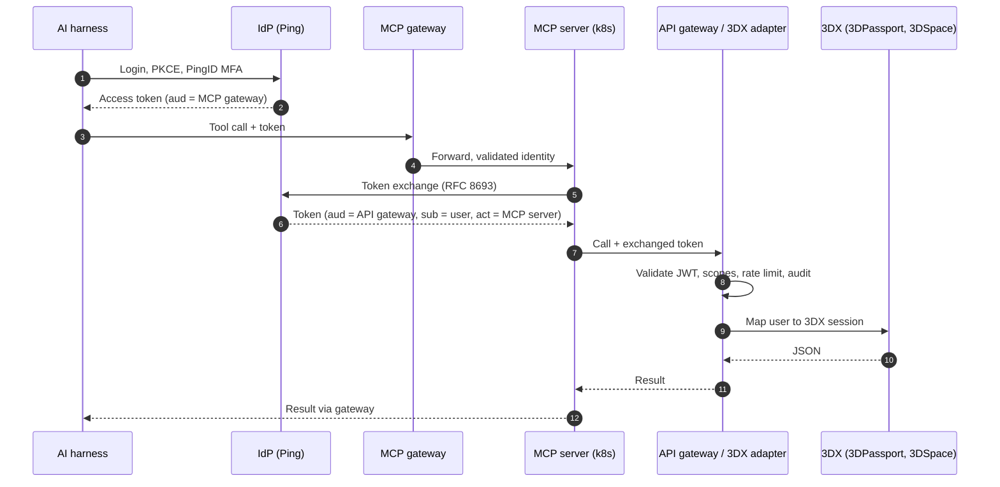

# 3DX, SAML and identity propagation through an MCP stack

Context: legacy on-prem VMware estate. Enterprise IdP is custom-built on Active Directory and PingID (assumed PingFederate as the SAML IdP). Most applications use SAML. Target backend is Dassault Systèmes 3DEXPERIENCE (3DX). Written 2026-11-26.

## 1. Short-lived access with SAML

SAML has no per-user "credential lifetime" field. Lifetime is controlled by the IdP and enforced (or not) by the application.

| Control | Where | Notes |
|---|---|---|
| Assertion validity (`NotBefore` / `NotOnOrAfter`) | IdP, per SP connection | How long the assertion can be used to log in. Applies to every user of that app. |
| Session lifetime (`SessionNotOnOrAfter`) | IdP sends, SP must honor | Many legacy SPs ignore it and use their own timeout. |
| App session timeout, clock skew | Application (SP) | The only truly application-side setting. |
| Per-user policy | IdP | Use an AD group or attribute to route users to an authentication policy with a short session or forced PingID re-auth. |

Per-user pattern in PingFederate (menu names vary by version):
1. Put the user in an AD group.
2. Add an authentication policy selector (Expression selector on group or attribute) that routes that group to its own policy path.
3. Give that path a short session, or force PingID re-authentication.
4. Shorten the assertion lifetime on the SP connection (affects all users of the app).
5. Optionally send a session-duration attribute, only useful if the app reads it.

Not verified: whether 3DPassport honors `SessionNotOnOrAfter`. Check the 3DPassport admin guide ("Configuring Federated SAML Mode") or ask DS. DS troubleshooting notes mention that 3DPassport checks `AuthnInstant` against `IssueInstant`, so a stale IdP session can be rejected.

**Time-sensitive:** DS announced that the default 3DPassport SAML signing and encryption test key expires on **2026-11-27**. If the platform still uses it, SAML sign-in may fail until you replace it with your own key and update the IdP.

## 2. 3DX APIs and 3DPassport

- Style: REST (CRUD endpoints), plus event/messaging over JMS and asynchronous export/import. No evidence of SOAP in DS public material.
- Services: 3DSpace (PLM/ENOVIA data), 3DSwym (collaboration), 3DPassport (authentication), and others. 3DSpace and FCS docs are OpenAPI based and downloadable.
- Serialization: JSON for the REST APIs; STEP AP242 for product/CAD exchange. Custom on-prem services (JPOs, custom JAX-RS) may return JSON or XML.
- Authentication: 3DPassport is the central identity and SSO service and uses a CAS-style ticket flow.
  - Local mode: 3DEXPERIENCE ID plus password.
  - Federated SAML mode ("authentication delegation"): 3DPassport is the SAML SP, your IdP authenticates the user. On first login the user must associate a 3DEXPERIENCE ID. 3DPassport expects an email attribute in the assertion.

### CAS-style flow (as used inside 3DX)
1. Client requests a protected resource.
2. Service redirects to the CAS server (3DPassport) with a `service` parameter.
3. User authenticates (here: redirect to the IdP via SAML, PingID MFA).
4. CAS sets its SSO session cookie and redirects back with a single-use `ticket`.
5. Service validates the ticket server-to-server with CAS.
6. Service creates its own session.

### SAML users and API clients
SAML is browser-only, so headless clients cannot complete it. Options:
- Interactive user session: follow the CAS redirect, user signs in via SAML once, client reuses the session.
- Integration agent (Enterprise Integration Architect, cloud): Basic-auth credentials acting through a proxy 3DPassport user. Reported as cloud-only.
- 3DPassport REST login for batch apps. Unconfirmed whether it works for SAML-federated accounts; likely a dedicated service account.

## 3. Identity propagation: harness to 3DX

Pattern: OAuth 2.0 authorization code + PKCE to the MCP gateway, then RFC 8693 token exchange at each hop. Never pass the original token downstream (MCP spec forbids token passthrough; confused deputy risk). Tokens are audience-bound using RFC 8707 resource indicators.

### The hard hop: API gateway to 3DX
3DX authenticates through 3DPassport, not OAuth, so something must translate the validated JWT into a 3DX session.

| Option | Pros | Cons |
|---|---|---|
| Per-user 3DX session | 3DX enforces per-person access rules | SAML users cannot log in headlessly. No documented on-behalf-of mechanism found; ask DS about trusted-application impersonation. |
| Agent / proxy user per person | Per-user licensing and identity | Heavy to provision; cloud-only as far as found. |
| Shared service account | Simple | 3DX sees one identity. The adapter must enforce per-user authorization; real user appears only in logs. |

### Controls
- Same email/UPN claim in the OAuth token as in the SAML assertion so the adapter maps to the same 3DX user.
- Access tokens 5 to 15 minutes; exchanged tokens shorter.
- mTLS between gateway, MCP servers and API gateway (service mesh or ingress).
- Log `sub` and `act` with a correlation id at every hop. Keep tokens out of logs.
- Service-account secrets in Vault or Kubernetes secrets, never in the image.
- Per-user short-lived access is enforced at the IdP for browser sessions only. API credentials (agents, service accounts) need their own rotation policy.

## Open questions for Dassault Systèmes
1. Does 3DPassport (on-prem release in use) honor `SessionNotOnOrAfter`?
2. Is there a supported on-behalf-of or trusted-application mechanism for acting as a federated user?
3. Can the 3DPassport REST login be used for SAML-federated accounts?
4. Which 3DX web services and endpoints exist in the installed on-prem release?

## Sources
- [3DEXPERIENCE platform openness](https://www.3ds.com/3dexperience-platform/openness)
- [Security | Integration | SAML (3DS community)](https://3dswym.3dexperience.3ds.com/wiki/3dexperience-platform-user-s-community/security-integration-saml_f7PMXLcbRyK40sPb2LL8WQ)
- [Authentication Delegation | SAML procedure](https://3dswym.3dexperience.3ds.com/wiki/3dexperience-platform-user-s-community/authentication-delegation-saml-procedure_UxrhxwiLQ2OfIZeg9En1cg)
- [3DPassport SAML default test key expiration](https://www.3ds.com/support/news/3dpassport-saml-default-test-key-expiration)
- [RESTful Web Services - Authentication Alternative](https://3dswym.3dexperience.3ds.com/post/enovia-user-community/3dexperience-restful-web-services-authentication-alternative_uizUNOc8Tcuh0Wj_pWm5og)
- [New changes on 3DPassport Service url](https://3dswym.3dexperience.3ds.com/post/3dexperience-platform-user-s-community/new-changes-on-3dpassport-service-url_y1tBP80iThGttF1sJTmDLQ)
- [Exploring 3DEXPERIENCE Public Web Services (COE)](https://coe.org/Content-Center/Content-Center-Details/coexperience-session-wrap-up-exploring-3dexperience-public-web-services)
- [CAS Protocol Specification](https://jasigcas.readthedocs.io/en/latest/cas-server-documentation/protocol/CAS-Protocol-Specification.html)
