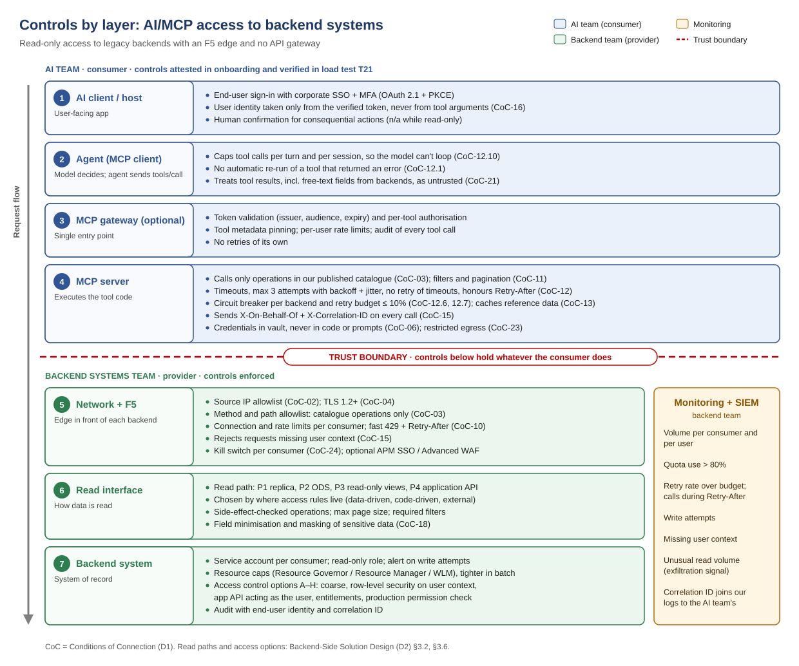

# Backend Provider Pack – AI/MCP Consumers

> **Owner:** Backend Systems (IT) · **Status:** Draft · **Date:** 2026-11-23
> **Consumer reference:** [../mcp-architecture.md](../mcp-architecture.md) describes how the AI team's platform (client, agent, MCP gateway, MCP servers) is expected to work. This pack is the **backend owner's side**.

## 1. Position

The AI team owns the AI clients, agents, MCP gateway and MCP servers. The Backend Systems team owns the systems those MCP servers read from. This pack sets out **the terms on which our backends can be consumed, and what we build to protect them**.

Guiding principles:

1. **Treat the AI platform as any other consumer.** Anything that must be true about our systems, we enforce on our side. We don't rely on the consumer's gateway, MCP servers or agent behaving as designed.
2. **Read-only by default.** Write use cases are out of scope. Each would need a separate request and review.
3. **Capacity first.** AI consumers get an explicit quota sized against measured headroom, enforced at the F5 and in the backend, with a kill switch.
4. **Act as the end user wherever the backend can accept it.** The target is **delegated, down-scoped end-user identity**: the backend applies its own access rules for that user, audit shows the real person, and the agent gets the user's access limited to read. Service accounts are the fallback for systems that can't accept delegated identity, in this order:

   | Identity tier | How | Backend applies the user's rules? |
   |---|---|---|
   | **1. Delegated user token** (target) | OAuth 2.0 **authorization code** grant: the user signs in interactively. Where a system relies on SAML, the SAML assertion is **exchanged for an OAuth token** (RFC 7522). Validated at F5 BIG-IP, which signs in onward to legacy backends as the user (Kerberos / trusted header). | Yes. The user is proven by a token the IdP signed, so the consumer can't invent a user. |
   | **2. Consumer token, user asserted** | OAuth 2.0 **client credentials** token for the consumer, plus the end user asserted per request and applied by the backend (proxy user, application "act as" API, database row-level security on session context) | Yes, but trusts the consumer to name the right user (CoC-16) |
   | **3. Consumer credential, rules enforced elsewhere** | Client credentials token, or a **service-account PAT where OAuth is unavailable**, with coarse data, ODS entitlements or a production permission check | No, or a reproduced copy. Needs explicit risk acceptance for sensitive data. |

   Whatever the tier, every call is **attributable to a person**: the end user's identity and a correlation ID are logged at the F5 and the backend. The consumer service also authenticates as itself, so per-consumer allowlists and quotas still apply.
5. **Use what we have.** **F5 BIG-IP is the API gateway.** It validates OAuth tokens and enforces the edge controls; native backend controls (read-only roles, views, resource governors, replicas) do the rest.
6. **Follow the organisation's credential standard.** OAuth 2.0 client credentials or authorization code grants, giving scoped, time-limited, revocable tokens. SAML assertions are exchanged for OAuth tokens, never presented directly to APIs. The AI never automates browser-based SAML logins. Service-account PATs are a fallback only where OAuth is unavailable. See D2 §3.3.



## 2. Deliverables

| # | Deliverable | Purpose | Audience / approver | File |
|---|---|---|---|---|
| D1 | **Conditions of connection** | Requirements the AI team must meet to connect to any backend | AI team, Security, ARB | [conditions-of-connection.md](conditions-of-connection.md) |
| D2 | **Backend-side solution design** | The standard controls we build: read-only path, service accounts, F5, resource caps, access control, monitoring, kill switch | Backend leads, Network/F5, DBAs, Security | [backend-solution-design.md](backend-solution-design.md) |
| D3 | **Readiness assessment** (one per backend) | Discovery record and verdict per system: ready / ready with conditions / not eligible | System owners, Security | [readiness-assessment-template.md](readiness-assessment-template.md) |
| D4 | **Capacity allocation (quota register)** | Consumer demand vs measured headroom, and the quota we grant | System owners, AI team | [effort-and-capacity-model.xlsx](effort-and-capacity-model.xlsx), *Quota Register* sheet |
| D5 | **Shared responsibility matrix** | Who owns each control (AI team, backend team or shared), with evidence | Both teams, Security | [shared-responsibility-matrix.md](shared-responsibility-matrix.md) |
| D6 | **Interface agreement / OLA** | Quotas, availability, change notice, incidents, right to throttle or cut off | Both team leads | [interface-agreement-ola.md](interface-agreement-ola.md) |
| D7 | **Onboarding process** | Repeatable path for each new backend or operation request | AI team, Backend leads | [onboarding-process.md](onboarding-process.md) |
| D8 | **Effort estimate & roadmap** | Backend-team effort only: one-off work plus a scored per-backend estimate | IT management | [effort-and-capacity-model.xlsx](effort-and-capacity-model.xlsx) + §4 |
| D9 | **ARB information item** | Inform the department of the approach and flag the decisions coming back to ARB | ARB | [arb-information-item.md](arb-information-item.md) |

## 3. Tasks

| Phase | ID | Task | Output | Depends on | Involves |
|---|---|---|---|---|---|
| **0. Mobilise** | T01 | Agree scope and principles with the AI team lead (read-only, provider stance) | Agreed scope note | – | AI team lead |
| | T02 | Get the AI team's use cases mapped to backend data, a demand forecast, source IPs, and how they'll pass user identity | Consumer intake | T01 | AI team |
| | T03 | Build the candidate backend list and prioritise (business value × likely readiness) | Prioritised list | T02 | System owners |
| | T04 | Confirm F5 modules licensed (LTM / Advanced WAF / APM) and who operates the F5 | Capability note | – | Network team |
| | T05 | Present the information item to ARB | ARB minutes | T01, T04 | ARB |
| **1. Standards** | T06 | Draft conditions of connection (D1) | D1 draft | T01 | Security |
| | T07 | Draft shared responsibility matrix (D5) | D5 draft | T06 | AI team, Security |
| | T08 | Draft the standard backend-side controls (D2) | D2 draft | T04 | DBAs, Network, Security |
| | T09 | Draft the onboarding process (D7) and OLA outline (D6) | D6, D7 drafts | T06 | Service management |
| **2. Discovery** | T10 | Readiness assessment per prioritised backend (D3): interfaces, load and headroom, read-only path, side effects, **where access rules live and how complex they are**, **highest identity tier the backend can support** and what it would take to reach a higher one, acceptable revocation lag, data classification | D3 per backend | T03, T08 | System SMEs, DBAs |
| | T11 | Measure peak utilisation and headroom per backend (≥ 2 weeks of monitoring, including month-end or batch peaks) | Headroom figures | T10 | Operations |
| | T12 | Check vendor terms and licensing for indirect / API access | Licence note per backend | T10 | Vendor management |
| | T13 | Allocate quotas (D4) and choose the access-control option per backend | Quota register, decisions | T02, T11 | System owners |
| | T14 | Score each backend and produce the estimate and roadmap (D8) | D8 | T10–T13 | IT management |
| **3. Build (pilot)** | T15 | Implement the read-only path (role, views, procedures, or replica) | Configured backend | T13 | DBAs |
| | T16 | Create service accounts, vault hand-over, write-attempt alerting | Accounts, alerts | T15 | IAM, Security |
| | T17 | Configure the F5: source allowlist, method/path allowlist, connection and rate limits, kill-switch rule | F5 config | T04, T13 | Network |
| | T18 | Configure backend resource caps for consumer accounts | Governor/WLM config | T13 | DBAs |
| | T19 | Set up monitoring and SIEM: volume per consumer and per user, anomalies, write attempts | Dashboards, alerts | T16 | Operations, SOC |
| **4. Verify** | T20 | Test read-only enforcement (attempt writes at every layer) | Test evidence | T15–T17 | Security |
| | T20a | Differential access test where rules are reproduced outside the application (options B, G, H): MCP-path results must match the application UI for each test user | Test evidence, regression suite | T15 | System SMEs, Security |
| | T21 | Load test at quota and at 2× quota. **Pass criteria:** (1) backend limits hold and other consumers are unaffected; (2) after `429`s, the consumer's request rate to the backend **drops** and stays at or below quota, rather than climbing; (3) retries stay within the CoC-12.7 budget; (4) during an injected backend outage, the consumer's circuit breaker opens and calls stop until it tests again | Load-test report | T17, T18 | Performance test, AI team |
| | T22 | Test the kill switch, and user attribution in audit logs | Test evidence | T17, T19 | Operations |
| | T23 | Sign the OLA (D6) and go live for the pilot | Signed OLA | T20–T22 | Both leads |
| **5. Scale** | T24 | Re-estimate using pilot actuals, then run the next backends through onboarding (D7) | Updated D8 | T23 | – |

## 4. Estimating effort

### 4.1 Approach

Estimate **only the backend team's work**: no MCP server or AI platform build. Split it into four parts:

```
Total = One-off work
      + Σ per backend ( assessment + build/config by complexity band + extra operations + non-development work )
      + contingency (by confidence)
```

1. **One-off work** – standards (D1, D2, D5–D7), the F5 control pattern, the monitoring pattern, ARB. Estimate bottom-up from the task list.
2. **Assessment per backend** – roughly fixed per band, because it's mostly discovery and measurement.
3. **Build per backend** – from the **complexity score** (§4.2), as a three-point estimate (optimistic / most likely / pessimistic), combined with the PERT formula `(O + 4M + P) / 6`.
4. **Extra operations** – each published read operation beyond the first three: design, side-effect check, view or procedure, F5 path rule, test.
5. **Non-development work, estimated separately per backend** – change approval, vendor engagement, security review, load testing. For legacy systems this is often a large share of the total, so estimate it explicitly rather than adding a flat percentage.
6. **Contingency by confidence** – low confidence (before assessment) 40%, medium (after assessment) 20%, high (after the pilot) 10%.

Give management **ranges**, label them with the confidence level, and **re-estimate after discovery and after the pilot**.

### 4.2 Complexity scoring (backend-team work only)

Score each factor 1–3.

| Factor | 1 | 2 | 3 |
|---|---|---|---|
| **Interface exposure** | Existing read API or view is usable | New views, procedures or API endpoints needed | New interface or adapter, or mainframe transaction |
| **Read-only path** | Replica or read-only role exists | Read-only role or views to create | Side effects to fix, or a replica/ODS to build |
| **Access-control option** | A – coarse | B – database row-level security on user context, or F – application API acting as the user | C – permission tables exposed to the consumer, D – per-user credentials, or G – ODS entitlements |
| **Access-rule reproduction** | Not needed (no user/role rules, or the application enforces its own rules via option E/F) | Data-driven rules reproduced in a copy or checked in production (B, H), with differential tests for a few roles | Code-driven or external (AD) rules reproduced, entitlements computed in an ODS (G), or differential tests across many roles and hierarchies |
| **Capacity controls** | Ample headroom, F5 limits only | Resource governor/WLM config needed | Near limit, per-use charges, or replica needed |
| **Data sensitivity** | Internal | Confidential | PII / regulated (masking views, privacy assessment) |
| **Operations published** | 1–3 | 4–8 | 9+ |
| **Environments & support** | Non-prod environment and SME available | Partial | No usable non-prod, or vendor-dependent |
| **Change / vendor constraints** | Standard change | Change board + vendor notification | Vendor engagement, licence review or change freeze |

| Total (9–27) | Band | Indicative build effort (person-days) | Assessment (person-days) |
|---|---|---|---|
| 9–13 | Simple | O 10 · M 15 · P 25 | 3 |
| 14–20 | Medium | O 20 · M 30 · P 50 | 5 |
| 21–27 | Complex | O 40 · M 60 · P 100 | 8 |

> **These figures are starting assumptions, not benchmarks.** Replace them with actuals from the first pilot backend. The spreadsheet holds them in an *Assumptions* sheet so they can be changed in one place.

### 4.3 Worked example

| Backend | Score | Band | Build PERT | Assessment | Extra ops | Non-dev | Subtotal |
|---|---|---|---|---|---|---|---|
| HR reference data (REST, read-only role exists, internal) | 11 | Simple | 15.8 | 3 | 0 | 5 | 23.8 |
| Orders DB (SQL Server, views + Resource Governor, confidential, 6 ops) | 16 | Medium | 31.7 | 5 | 6 | 12 | 54.7 |

Add one-off work (e.g. 35 days) and 20% contingency at medium confidence: **(35 + 23.8 + 54.7) × 1.2 ≈ 136 person-days.** The same inputs give a range of **115–169 person-days** (optimistic to pessimistic), which is what to present. The spreadsheet reproduces this example.

## 5. Presenting at ARB

See [arb-information-item.md](arb-information-item.md) for the paper, slide outline, key messages and likely questions.

Summary of the approach:
- **Frame it as information, not a decision.** The point is to make the department aware of our stance, our standards, and the decisions that will come back to ARB.
- **Align with the AI team first.** Ideally they co-present for two minutes, or endorse D1 and D5 before the meeting.
- **Keep it to about 6 slides and a 1-page paper.** Don't present the AI team's architecture; reference it.
- **End with the list of decisions coming back**, e.g. replica/ODS investment, F5 APM or WAF licensing, and the access-control option for sensitive systems.
