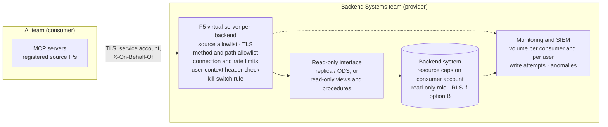

# D2 – Backend-Side Solution Design for AI/MCP Consumers

> **Owner:** Backend Systems (IT) · **Status:** Draft
> Standard controls the backend team builds for every backend exposed to AI/MCP consumers. Each backend's readiness assessment (D3) records how these apply and any exceptions.

## 1. Context and constraints

* Most backends are **legacy**. Many can't validate OAuth/JWT/SAML claims, so they can't enforce *who the user is* from a token.
* There is **no API gateway**. The **F5** is the only edge component available.
* The AI team owns everything upstream: AI clients, agents, MCP gateway and MCP servers. We treat their platform as an external consumer.
* Scope is **read-only** access.

## 2. Control architecture

## 3. Standard controls

### 3.1 Published operation catalogue
* For each backend we publish a catalogue of read operations: API path and method, view, or stored procedure.
* Each entry lists:
  - **parameters, with required filters**;
  - **maximum page size**;
  - **fields returned, and their data classification**;
  - **cache TTL** the consumer should apply;
  - the result of the **side-effect check**.
* Side-effect check: confirm the operation doesn't update "last viewed" or audit stamps, take locks (`SELECT … FOR UPDATE`, pessimistic locks), write log rows into business tables, or trigger jobs.

### 3.2 Read-only path (choose per backend, in order of preference)
1. **Replica or standby** opened read-only. Physically can't be written to, and has its own capacity.
2. **Existing ODS, reporting database or warehouse**, where data a few minutes old is acceptable.
3. **Read-only views or stored procedures** on production, granted to a role that has nothing else.
4. **Read-only application role** for API-based systems, where the application supports one.

### 3.3 Service accounts
* One account per consumer service per backend per environment. Non-interactive. Least privilege: only the catalogue's objects.
* Credentials handed over through the consumer's secrets store and rotated every 90 days or on demand.
* **Alert on any write or permission-denied event** for these accounts (CoC-09).

### 3.4 F5 configuration (per backend virtual server)

| Control | LTM | Advanced WAF | APM |
|---|---|---|---|
| Source IP allowlist, TLS profile | ✓ | | |
| Method and path allowlist (iRule or policy) | ✓ (iRule) | ✓ (OpenAPI/schema enforcement) | |
| Connection limit and connection-rate limit per pool member | ✓ | | |
| Request rate limit per consumer (iRule with tables) | ✓ | ✓ (L7 DoS) | |
| Reject requests without `X-On-Behalf-Of` / `X-Correlation-ID` | ✓ (iRule) | | |
| Kill-switch rule (data group toggle that blocks a consumer) | ✓ | | |
| Validate consumer JWT, or single sign-on to backend (Kerberos, header) | | | ✓ |

> Confirm which modules are licensed (task T04). LTM alone covers the essentials. APM would let selected backends receive a real user identity (Kerberos constrained delegation or header-based SSO) without changing the backend.

### 3.5 Backend resource caps
Cap what consumer accounts can use, so even a misbehaving consumer can't starve other users:
* **SQL Server:** Resource Governor workload group and pool for consumer logins (CPU, memory grant, max requests).
* **Oracle:** Resource Manager consumer group, session and parallel limits, profile `SESSIONS_PER_USER`.
* **Db2 / z/OS:** WLM service class with low importance and resource caps. Watch for MIPS chargeback.
* **Application servers:** dedicated thread pool or connection pool for the consumer, where supported.
* **Tighter caps during batch windows** (scheduled change of limits, or an F5 time-based rule).

### 3.6 Access control (choose per backend)

| Option | How | Use when |
|---|---|---|
| **A. Coarse** | Only expose data every permitted user may see | Reference or low-sensitivity data. Default for pilots. |
| **B. Database row-level security on user context** | Consumer sets the user per request (CoC-15). Policies filter rows: Oracle VPD, SQL Server RLS with `SESSION_CONTEXT`, PostgreSQL RLS | Object-level access is needed and direct database access is acceptable. Relies on CoC-16. |
| **C. Expose permission data to the consumer** | We publish a view of the backend's own access-rule tables, and the consumer's MCP server filters results | Last resort. Duplicates logic, and a consumer bug exposes everything the account can read. |
| **D. Per-user credentials** | Users link their own backend login (see consumer architecture, Flow C) | Systems that only accept per-user logins. High operational cost. |
| **E. F5 APM single sign-on** | APM validates the consumer token and signs in to the backend as the user (Kerberos/header) | APM is licensed and the backend supports Kerberos or trusted headers. |

### 3.7 User attribution and audit
* Log `X-On-Behalf-Of` and `X-Correlation-ID` at the F5. Store the database client identifier / session context in backend audit trails where the database supports it.
* Ship F5 and backend audit events to the SIEM, keyed by correlation ID, so a call can be traced end to end with the consumer's logs.

### 3.8 Monitoring and alerting
* Dashboards per consumer and backend: requests per second, concurrency, latency, errors, throttling events.
* Alerts:
  - write or permission-denied events;
  - sustained use above 80% of quota;
  - unusual read volume per user, the main signal for data exfiltration through read-only access;
  - requests missing user context;
  - access from unregistered sources.

### 3.9 Kill switch
* **Level 1:** F5 data-group entry that blocks a consumer (seconds, affects only that consumer).
* **Level 2:** disable the consumer's service account.
* Runbook owned by Operations, tested before go-live (T22).

## 4. Per-backend decisions to record (in D3)

| Decision | Options |
|---|---|
| Read-only path | 3.2 options 1–4 |
| Access control | 3.6 options A–E |
| Quota | Rate, concurrency, time windows (D4) |
| Data classes approved for LLM processing | From classification and privacy assessment |
| Exceptions to standard controls | With compensating control and risk owner |

## 5. Risks and dependencies

| Risk / dependency | Impact | Mitigation |
|---|---|---|
| F5 modules not licensed (APM / Advanced WAF) | Fewer edge controls, no SSO option E | LTM iRules for essentials. Raise licensing as an ARB decision. |
| No realistic non-production environment | Can't load test or verify controls | Build or refresh one as part of the backend's effort, or limit to option A on a replica |
| Vendor terms on indirect / API access | Licence cost or breach | Check per backend (T12) before build |
| Consumer sets wrong user identity (option B) | Data shown to the wrong user | CoC-16 evidence, two-user contract test, audit review |
| Agent demand exceeds forecast | Backend saturation | Hard caps at the F5 and backend, quota review in OLA |
