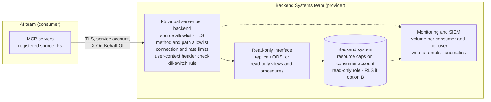
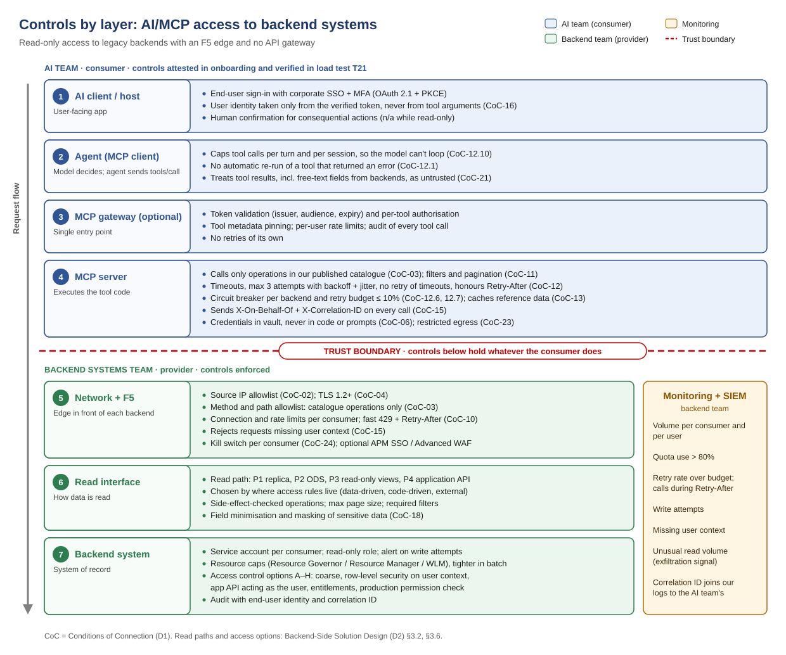

# D2 – Backend-Side Solution Design for AI/MCP Consumers

> **Owner:** Backend Systems (IT) · **Status:** Draft
> Standard controls the backend team builds for every backend exposed to AI/MCP consumers. Each backend's readiness assessment (D3) records how these apply and any exceptions.

## 1. Context and constraints

* Most backends are **legacy**. Many can't validate OAuth/JWT/SAML claims, so they can't enforce *who the user is* from a token.
* There is **no API gateway**. The **F5** is the only edge component available.
* The AI team owns everything upstream: AI clients, agents, MCP gateway and MCP servers. We treat their platform as an external consumer.
* Scope is **read-only** access.

## 2. Control architecture

### 2.1 Controls by layer

Layers 1–4 belong to the AI team. Their controls are attested in onboarding and verified in load test T21. Layers 5–7 and monitoring belong to us and are enforced, so they hold whatever the consumer does.

## 3. Standard controls

### 3.1 Published operation catalogue
* For each backend we publish a catalogue of read operations: API path and method, view, or stored procedure.
* Each entry lists:
  - **parameters, with required filters**;
  - **maximum page size**;
  - **fields returned, and their data classification**;
  - **cache TTL** the consumer should apply;
  - the result of the **side-effect check**.
* Side-effect check: confirm the operation doesn't update "last viewed" or audit stamps, take locks (`SELECT … FOR UPDATE`, pessimistic locks), write log rows into business tables, or trigger jobs.

### 3.2 Read-only path (choose per backend, together with access control in §3.6)

Available read paths:

| Path | What it is | Freshness |
|---|---|---|
| **P1. Read replica / standby** | Exact copy of the source database opened read-only (e.g. Oracle Active Data Guard, SQL Server readable secondary). Physically can't be written to, with its own capacity. | Seconds |
| **P2. ODS (Operational Data Store)** | Separate database holding a near-current, reshaped copy of operational data, fed by CDC or ETL. Often already exists for reporting or integration. | Minutes to hours |
| **P3. Read-only views / stored procedures on production** | Granted to a role that has nothing else | Live |
| **P4. Application API on production** | The application's own read API, using a read-only application role | Live |

**A copy (P1, P2) bypasses access rules that the application enforces in code.** The data is copied, but the rule deciding which user sees which entities isn't. The read path can't be chosen on capacity alone, so first establish **where the access rules live**:

| Where access rules live | Meaning | Read paths that can preserve them | Access-control options (§3.6) |
|---|---|---|---|
| **None / not needed** | Data is visible to every permitted user (reference data) | P1, P2, P3, P4 | A |
| **Data-driven** | Permission tables in the database: user → role → entity, owner columns, team assignments | P1 or P3 with database row-level security joining those tables. P2 with pre-computed entitlements. Or P1/P2 data with a production permission check. | B, G, H |
| **Code-driven** | Rules in application code: hierarchies, status-dependent visibility, delegations, time-based or field-level rules | P4 acting as the user. Reproducing these rules outside the app is high-risk. | F, E |
| **External** | Roles from AD/LDAP groups not stored in the database | As for data-driven, **plus** a feed of group membership into the copy or the policy | B, G, H (with group feed) |

Default order of preference when capacity is the concern:
1. **Split by sensitivity:** serve reference and non-sensitive entities from P1/P2 with option A, and serve entities under user/role access rules through H or F only.
2. **Data from a copy, permission check from production (option H):** most load moves off production, and revocations take effect immediately.
3. **Rules enforced in the copy (options B on P1, or G on P2):** fully offloaded, but permissions are as stale as the copy.
4. **Application API acting as the user (option F):** most accurate. Capacity is protected by quotas and resource caps (§3.4, §3.5) rather than by offloading.

**Revocation lag.** Any copy carries permissions as of its last refresh. Record per backend how long a revoked user may still see data through the copy (seconds for P1, possibly hours for a batch-fed P2). If no lag is acceptable, use H or F.

**Notes on enforcing rules in copies**
* **A physical replica (P1) is read-only, so objects can't be created on it.** Create the views or row-level security policies on the **primary** (a small schema change) and they replicate across. SQL Server RLS and Oracle VPD policies defined on the primary apply on readable secondaries.
* **Packaged vendor schemas may forbid custom objects.** Use a separate schema, and check vendor support terms (task T12).

### 3.3 Service accounts
* One account per consumer service per backend per environment. Non-interactive. Least privilege: only the catalogue's objects.
* Credentials handed over through the consumer's secrets store and rotated every 90 days or on demand.
* **Alert on any write or permission-denied event** for these accounts (CoC-09).

### 3.4 F5 configuration (per backend virtual server)

| Control | LTM | Advanced WAF | APM |
|---|---|---|---|
| Source IP allowlist, TLS profile | ✓ | | |
| Method and path allowlist (iRule or policy) | ✓ (iRule) | ✓ (OpenAPI/schema enforcement) | |
| Connection limit and connection-rate limit per pool member | ✓ | | |
| Request rate limit per consumer (iRule with tables) | ✓ | ✓ (L7 DoS) | |
| Over quota: reply **immediately** with `429` and `Retry-After`, without queueing (fast rejection keeps load off the backend and lets consumer backoff work, CoC-12) | ✓ (iRule) | ✓ | |
| Reject requests without `X-On-Behalf-Of` / `X-Correlation-ID` | ✓ (iRule) | | |
| Kill-switch rule (data group toggle that blocks a consumer) | ✓ | | |
| Validate consumer JWT, or single sign-on to backend (Kerberos, header) | | | ✓ |

> Confirm which modules are licensed (task T04). LTM alone covers the essentials. APM would let selected backends receive a real user identity (Kerberos constrained delegation or header-based SSO) without changing the backend.

### 3.5 Backend resource caps
Cap what consumer accounts can use, so even a misbehaving consumer can't starve other users:
* **SQL Server:** Resource Governor workload group and pool for consumer logins (CPU, memory grant, max requests).
* **Oracle:** Resource Manager consumer group, session and parallel limits, profile `SESSIONS_PER_USER`.
* **Db2 / z/OS:** WLM service class with low importance and resource caps. Watch for MIPS chargeback.
* **Application servers:** dedicated thread pool or connection pool for the consumer, where supported.
* **Tighter caps during batch windows** (scheduled change of limits, or an F5 time-based rule).

### 3.6 Access control (choose per backend)

| Option | How | Use when |
|---|---|---|
| **A. Coarse** | Only expose data every permitted user may see | Reference or low-sensitivity data. Default for pilots. |
| **B. Database row-level security on user context** | Consumer sets the user per request (CoC-15). Policies filter rows: Oracle VPD, SQL Server RLS with `SESSION_CONTEXT`, PostgreSQL RLS | Object-level access is needed and direct database access is acceptable. Relies on CoC-16. |
| **C. Expose permission data to the consumer** | We publish a view of the backend's own access-rule tables, and the consumer's MCP server filters results | Last resort. Duplicates logic, and a consumer bug exposes everything the account can read. |
| **D. Per-user credentials** | Users link their own backend login (see consumer architecture, Flow C) | Systems that only accept per-user logins. High operational cost. |
| **E. F5 APM single sign-on** | APM validates the consumer token and signs in to the backend as the user (Kerberos/header) | APM is licensed and the backend supports Kerberos or trusted headers. |
| **F. Application API acting as the user** | The consumer calls the application's own API with an "act as" / impersonation parameter or proxy user, so the **application's own access rules** run | Code-driven access rules. The application must support acting as a user for a trusted service account. |
| **G. Pre-computed entitlements in an ODS** | While loading the ODS, flatten the access rules into an entitlement table (which user or role can see which entity, including AD group membership). Every ODS query is filtered against it. | Data-driven or external rules spread across several tables. We own the entitlement logic and must keep it in step with the application. |
| **H. Copy for data, production for permission** | Entity data is read from P1/P2. "Can this user see entity X?" is checked against the production application or its permission tables (a small, cheap lookup) | Sensitive data where stale permissions aren't acceptable, but load must still move off production. |

> **Verification for options B, G and H (rules reproduced outside the application): differential testing.** For a sample of test users covering each role, team and hierarchy level, compare the entities returned through the MCP path with what the application's UI shows each user. They must match exactly. This is a go-live gate (T20) and a **regression test after every application upgrade**, because access rules change with upgrades.

### 3.7 User attribution and audit
* Log `X-On-Behalf-Of` and `X-Correlation-ID` at the F5. Store the database client identifier / session context in backend audit trails where the database supports it.
* Ship F5 and backend audit events to the SIEM, keyed by correlation ID, so a call can be traced end to end with the consumer's logs.

### 3.8 Monitoring and alerting
* Dashboards per consumer and backend: requests per second, concurrency, latency, errors, throttling events.
* Alerts:
  - write or permission-denied events;
  - sustained use above 80% of quota;
  - retry rate above the CoC-12.7 budget, or requests continuing during `Retry-After` periods;
  - unusual read volume per user, the main signal for data exfiltration through read-only access;
  - requests missing user context;
  - access from unregistered sources.

### 3.9 Kill switch
* **Level 1:** F5 data-group entry that blocks a consumer (seconds, affects only that consumer).
* **Level 2:** disable the consumer's service account.
* Runbook owned by Operations, tested before go-live (T22).

## 4. Per-backend decisions to record (in D3)

| Decision | Options |
|---|---|
| Where access rules live | None / data-driven / code-driven / external (§3.2) |
| Read path | P1–P4 (§3.2), per entity type if split by sensitivity |
| Access control | §3.6 options A–H |
| Acceptable revocation lag | Seconds / minutes / hours / none |
| Quota | Rate, concurrency, time windows (D4) |
| Data classes approved for LLM processing | From classification and privacy assessment |
| Exceptions to standard controls | With compensating control and risk owner |

## 5. Risks and dependencies

| Risk / dependency | Impact | Mitigation |
|---|---|---|
| F5 modules not licensed (APM / Advanced WAF) | Fewer edge controls, no SSO option E | LTM iRules for essentials. Raise licensing as an ARB decision. |
| No realistic non-production environment | Can't load test or verify controls | Build or refresh one as part of the backend's effort, or limit to option A on a replica |
| Vendor terms on indirect / API access | Licence cost or breach | Check per backend (T12) before build |
| Consumer sets wrong user identity (options B, G, H) | Data shown to the wrong user | CoC-16 evidence, two-user contract test, audit review |
| Reproduced access rules drift from the application's (options B, G, H) | Users see entities the application would hide | Differential testing at go-live and after every application upgrade. Prefer F for code-driven rules. |
| Stale permissions in a copy (P1, P2) | A revoked user still sees data until the next refresh | Agree acceptable lag per backend. Use H for sensitive entities. |
| Agent demand exceeds forecast | Backend saturation | Hard caps at the F5 and backend, quota review in OLA |
