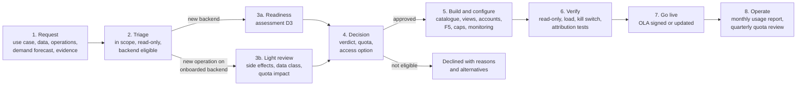

# D7 – Onboarding Process: New Backend or New Operation

> **Owner:** Backend Systems (IT) · **Status:** Draft

| Step | What | Who | Target duration |
|---|---|---|---|
| 1. Request | AI team submits the intake: use case, data and operations needed, demand forecast, evidence (CoC-22) | AI team | – |
| 2. Triage | Check scope (read-only, approved backend), completeness, priority | Backend architect | 3 business days |
| 3a. Readiness assessment | Full D3 for a new backend, including capacity measurement | System SME, DBA, architect | 2–6 weeks (depends on the measurement period) |
| 3b. Light review | New operation on an onboarded backend: side effects, data classification, quota impact | System SME | 5 business days |
| 4. Decision | Verdict, quota, access-control option, exceptions | System owner, Security | 5 business days |
| 5. Build | Per D2 | Backend team, Network, DBAs | Per estimate (D8) |
| 6. Verify | T20–T22 tests | Backend team, Security | 1–2 weeks |
| 7. Go live | OLA signed or schedules updated | Both owners | – |
| 8. Operate | Monitoring, monthly report, quarterly review | Operations | Ongoing |

**Inputs required from the AI team at step 1:** use cases mapped to data, operations needed, demand forecast (users, peak calls per second, hours), source IPs, how user identity is derived and passed (CoC-15/16), threat model and security test results.
