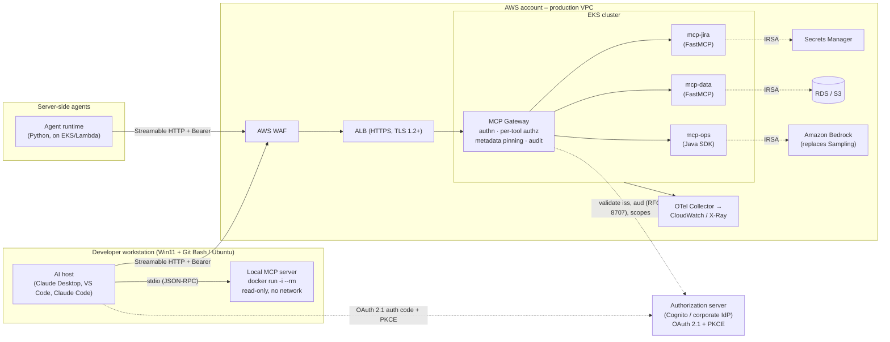

# MCP Reference Architecture – Secure, Containerised, AWS-Hosted

> **Status:** Proposed · **Date:** 2026-10-18 · **Target spec:** MCP `2026-07-28` (with `2025-11-25` back-compat)
> **Companion:** [security-concerns.md](security-concerns.md) – threat catalogue referenced below as `SC-xx`.

## 1. Purpose

This document defines how we build, ship and run **Model Context Protocol (MCP)** servers. It covers the path from a developer laptop (Windows 11 + Git Bash, or Ubuntu, VS Code) to production on AWS. The goal is to keep MCP's main benefit, one integration usable by every AI host, while closing the security and operational traps that the default "`npx`/`uv` on your laptop" pattern creates.

**Stack choices**

| Concern | Choice |
|---|---|
| Server language | Python (FastMCP / official `mcp` SDK). Java SDK where a JVM integration fits better |
| Packaging | Docker images, published to **Docker Hub**, always referenced **by digest** |
| Source control & CI/CD | **GitHub** + GitHub Actions (OIDC to AWS, no long-lived keys) |
| Runtime | **AWS EKS** (Fargate or managed node groups), deployed with Helm |
| Remote transport | **Streamable HTTP** only. No HTTP+SSE |
| Local transport | **stdio, but only into a container** (`docker run -i`), never a bare host process |

## 2. Review of the source material

The input article is broadly sound. Its conclusions (stderr-only logging, Streamable HTTP + OAuth 2.1, containerised isolation, metadata-as-code) are adopted here. Its key claims were checked against primary and secondary sources. The corrections and additions below affect the design:

| Article claim | Verified position | Design impact |
|---|---|---|
| OX Security stdio RCE; ~200,000 instances exposed | Confirmed (disclosed April 2026, reported to Anthropic January 2026). The ~200k figure is an **extrapolation** from ~7,000 publicly reachable stdio servers actually scanned. RCE was confirmed on six live production platforms, and 9 of 11 MCP registries accepted OX's benign PoC without review. | Treat stdio launch config as untrusted code (SC-01). Registry trust is not a control (SC-10). |
| Anthropic "refused to patch" | Anthropic called the behaviour *expected/by design*, updated `SECURITY.md` to advise caution with stdio, and placed sanitisation on implementers. Its argument is that sanitising stdio would break the transport or just move the payload. | We do not wait for a protocol fix. Isolation is our control, not input filtering. |
| Allowlisting `python`/`npx` is bypassable (`npx -c …`) | Confirmed (CSA research note; OX bypassed a Flowise/Upsonic allowlist). | Allowlist the **whole command line** (image digest), not the executable name. |
| Sampling & Logging deprecated in `2026-07-28` | Correct, and **Roots is also deprecated**. All three stay functional for a minimum 12-month deprecation window. | Servers call LLM provider APIs directly (e.g. Amazon Bedrock). Logs go to stderr/OpenTelemetry. Paths come from tool parameters, not Roots. |
| "Elicitation rises via `elicitation/create`" | Partly outdated. In `2026-07-28`, server-initiated `elicitation/create`, `sampling/createMessage` and `roots/list` are **replaced by Multi Round-Trip Requests (MRTR)**: a tool returns an `InputRequiredResult` and the client retries with `inputResponses`. | Human-in-the-loop confirmation is built on MRTR (`resultType: "input_required"`). |
| Streamable HTTP is "stateless" | `2026-07-28` makes it **truly** stateless. The `initialize` handshake, protocol sessions and the `Mcp-Session-Id` header are removed. Version, capabilities and client identity travel in each request's `_meta`, and `server/discover` is required. | No sticky sessions. Plain ALB round-robin and horizontal pod autoscaling work. |
| HTTP+SSE deprecated by `2025-03-26` | Confirmed. | Not supported anywhere in this architecture. |
| Python `logging` "routes safely to stderr" | True for the *destination*. But an unconfigured logger only emits `WARNING`+ via the last-resort handler, so `logger.info()` silently disappears. | Call `logging.basicConfig(stream=sys.stderr, level=…)` explicitly (see §7). |

## 3. Architecture principles

1. **Isolation over sanitisation.** Filtering commands and prompts is necessary but bypassable. Every MCP server runs in a container with the smallest possible blast radius, so a successful injection reaches very little.
2. **Remote by default, local by exception.** Shared or production tools are remote Streamable HTTP services. Local stdio is for personal developer tooling only, and even then it runs inside a container.
3. **One front door.** All remote MCP traffic enters through an **MCP Gateway** that authenticates, authorises per tool, pins metadata and audits. Servers are never exposed directly.
4. **Metadata is code.** Tool names, descriptions and schemas are reviewed, versioned, hashed and pinned like source code.
5. **Least privilege per server.** Each server gets its own IAM role, secrets scope, network egress allowlist and Kubernetes namespace.
6. **Humans approve consequences.** Destructive, financial or data-exporting tools require explicit user confirmation via MRTR, enforced server-side.
7. **Stateless and disposable.** No protocol sessions and no local state, so pods can be killed, scaled and replaced freely.

## 4. Logical architecture



### 4.1 Components

| Component | Responsibility | Key controls |
|---|---|---|
| **AI hosts** | Claude Desktop, VS Code, Claude Code, custom agents. MCP clients. | Config managed from a Git repo, not hand-edited. Only approved gateway URLs and pinned local images. |
| **Local MCP servers** (dev only) | Personal tools needing local context (e.g. a repo linter). | Launched as `docker run -i --rm` with a pinned digest, `--read-only`, `--network none` unless needed, a single bind-mounted working folder, non-root user. |
| **AWS WAF + ALB** | TLS termination, L7 filtering, rate limits. | Managed rule groups, body-size limits, geo/IP restrictions for admin tools. |
| **MCP Gateway** | Single ingress for every remote MCP server. Can be built on an open-source MCP gateway/proxy or a thin FastAPI service. | OAuth token validation, per-tool RBAC, tool-catalogue pinning (description hashes), tool-name namespacing, request/response size limits, audit log, response scanning for injection markers. |
| **MCP servers** | One container per bounded domain (Jira, data, ops…). Streamable HTTP, stateless. | IRSA role per server, NetworkPolicy default-deny egress, read-only root FS, non-root, seccomp `RuntimeDefault`, no shell in image (distroless). |
| **Authorization server** | Issues audience-bound access tokens. | OAuth 2.1, PKCE, short-lived tokens, Client ID Metadata Documents preferred over Dynamic Client Registration (deprecated in `2026-07-28`). |
| **Secrets Manager** | Downstream API credentials. | Fetched at runtime via IRSA. Never in `mcp.json`, images or env files committed to Git. |
| **Amazon Bedrock** | LLM calls a server needs internally. | Replaces client Sampling. The server holds its own model access, so no implicit trust in the host. |
| **Observability** | Logs, traces, metrics. | stderr → Fluent Bit → CloudWatch. OTel traces propagated via the spec's `_meta` trace keys. PII redaction before export. |

## 5. Transport strategy and rationale

| Use case | Transport | Why |
|---|---|---|
| Personal dev tool needing local files | **stdio → container** | Zero network surface. The container contains the OX-style launch-command risk because the only command the host runs is `docker` with a pinned image digest, reviewed in Git. |
| Shared team or production tool | **Streamable HTTP via gateway** | Multi-tenant, OAuth-protected, auditable, horizontally scalable. Lifecycle owned by Kubernetes, not by the desktop app (no zombie processes). |
| Agent-to-tool inside AWS | **Streamable HTTP, in-VPC** | Same server image and same auth model. Internal ALB with no internet path. |
| Legacy HTTP+SSE server | **Not allowed** | Deprecated since `2025-03-26`. Wrap it behind the gateway or rewrite it. |

**Rationale for remote-first.** Running stdio servers natively on a laptop gives them the user's full permissions: SSH keys, cloud credentials, browser profiles. Their lifecycle is also tied to the host app. Moving shared tools to EKS gives us process isolation, central audit, and CI/CD-controlled versions in one move. Stateless Streamable HTTP in `2026-07-28` removes the last reason to need sticky sessions, so standard AWS load balancing applies.

### 5.1 Hardened local stdio pattern

Example host config (Claude Desktop / VS Code `mcp.json`), committed to a dotfiles repo and reviewed:

```json
{
  "mcpServers": {
    "repo-linter": {
      "command": "docker",
      "args": [
        "run", "-i", "--rm",
        "--read-only", "--network", "none",
        "--cap-drop", "ALL", "--security-opt", "no-new-privileges",
        "--user", "10001:10001",
        "-v", "${workspaceFolder}:/work:ro",
        "joshuamfrancis/mcp-repo-linter@sha256:<digest>"
      ]
    }
  }
}
```

* `command` is always `docker`, and `args` are fixed. Anything that writes this config programmatically must reject user-controlled `command`/`args` (SC-01, SC-02).
* On Windows 11 with Git Bash, Docker Desktop's WSL2 backend handles this. Use forward-slash paths in bind mounts, or set `MSYS_NO_PATHCONV=1` when testing the command from Git Bash, which otherwise rewrites `/work`.

## 6. Security architecture (controls mapped to threats)

Full threat descriptions are in [security-concerns.md](security-concerns.md).

| Layer | Control | Threats addressed |
|---|---|---|
| **Launch** | stdio only via `docker run` with digest-pinned images. Config generated from Git, never from user/LLM input. | SC-01, SC-02, SC-09 |
| **Isolation** | Containers: non-root, read-only FS, dropped capabilities, distroless, NetworkPolicy default-deny egress, per-server namespace and IRSA. | SC-01, SC-08, SC-12 |
| **Identity** | OAuth 2.1 + PKCE. RFC 9728 `/.well-known/oauth-protected-resource`. RFC 8707 resource indicators, with `aud` validated on every request. RFC 9207 `iss` validated. | SC-05, SC-06, SC-07 |
| **No token passthrough** | The gateway and servers never forward the client's token downstream. Servers use their own IRSA/Secrets Manager credentials, or OAuth token exchange. | SC-06 |
| **Authorisation** | Per-tool RBAC at the gateway (scope → tool allowlist). Read-only tools separated from write tools into different servers. | SC-06, SC-11 |
| **Metadata integrity** | Tool catalogue reviewed in PR. SHA-256 of each tool's name + description + schema pinned at the gateway, and a drifted tool is blocked until re-approved. Tool names namespaced (`jira.create_issue`). | SC-03, SC-04 |
| **Content safety** | Tool results treated as untrusted data. The gateway caps size and flags instruction-like content. Hosts keep a human review step for actions triggered by retrieved content. | SC-03, SC-13 |
| **Human-in-the-loop** | Destructive/export tools return `InputRequiredResult` (MRTR) for confirmation before acting. The server re-checks the confirmation token. | SC-11, SC-13 |
| **Supply chain** | Images built only in GitHub Actions, scanned (Trivy), SBOM'd (Syft), signed (cosign keyless via GitHub OIDC), pushed to Docker Hub, deployed by digest. Kyverno admission policy verifies signatures. Third-party servers are vendored and rebuilt, not pulled live. | SC-09, SC-10 |
| **Wire hygiene** | stdout reserved for JSON-RPC. Lint rule bans `print()` / `System.out` in server code. Explicit stderr logging. | SC-14 |
| **Local HTTP (if ever used)** | Bind to `127.0.0.1` only, validate the `Origin` header, require auth. | SC-15 |
| **Audit & detection** | Gateway logs every `tools/call` (caller, tool, args hash, result size, latency) to CloudWatch, with alarms on new tools, auth failures and egress denials. | All |

## 7. Server implementation standards (Python)

```python
import logging, sys
from mcp.server.fastmcp import FastMCP

# stdout is the JSON-RPC wire for stdio – log to stderr explicitly, at the level you want.
logging.basicConfig(stream=sys.stderr, level=logging.INFO,
                    format="%(asctime)s %(levelname)s %(name)s %(message)s")
log = logging.getLogger("mcp-jira")

mcp = FastMCP("jira")

@mcp.tool()
def create_issue(project_key: str, summary: str) -> dict:
    """Create a Jira issue in PROJECT_KEY with a one-line SUMMARY.
    Use only when the user explicitly asks to file a ticket. Returns the new issue key."""
    ...

if __name__ == "__main__":
    mcp.run(transport="streamable-http")  # or "stdio" for the local containerised pattern
```

* **Descriptions:** state what the tool does, when to use it, and its constraints. Never include instructions about *other* tools, or about secrecy or exfiltration. CI fails on suspicious patterns (`ignore previous`, `do not tell the user`, URLs, base64 blobs).
* **Inputs:** validate with JSON Schema / Pydantic. Never pass arguments to a shell. Use `subprocess.run([...], shell=False)` with fixed argv when a subprocess is unavoidable.
* **Outputs:** return `structuredContent` where possible and keep free text minimal. That narrows the injection surface for the model.
* **Java:** the same rules apply. Use SLF4J with a stderr appender, and ban `System.out.println` via Checkstyle.

## 8. Delivery pipeline (GitHub → Docker Hub → AWS)

```mermaid
flowchart LR
    PR["Pull request"] --> CI["GitHub Actions CI<br/>ruff · pytest · bandit<br/>stdout-print lint<br/>tool-metadata lint + diff"]
    CI --> REV["CODEOWNERS review<br/>(metadata changes need security approval)"]
    REV --> BUILD["Build image<br/>distroless, non-root"]
    BUILD --> SCAN["Trivy scan · Syft SBOM"]
    SCAN --> SIGN["cosign sign (keyless, GitHub OIDC)"]
    SIGN --> HUB["Docker Hub<br/>push, record digest"]
    HUB --> DEPLOY["Helm upgrade via GitHub Actions<br/>OIDC → AWS role · image by digest"]
    DEPLOY --> EKS["EKS<br/>Kyverno verifies signature"]
    EKS --> PIN["Gateway: approve new<br/>tool-catalogue hashes"]
```



* **Docker Hub in production:** use a paid/org plan to avoid pull rate limits. Alternatively, put an **ECR pull-through cache** in front of Docker Hub, which also keeps image pulls inside AWS. Either way, deploy by `@sha256:` digest, never by mutable tag.
* **AWS access from Actions:** OIDC federation to a scoped deploy role. No access keys in GitHub secrets.
* **Branch protection:** signed commits, required reviews, and CODEOWNERS on `**/tools/**` and the gateway policy.

## 9. Operational model

| Topic | Approach |
|---|---|
| Scaling | HPA on CPU/RPS. Stateless, so any pod serves any request. |
| Long-running work | Return quickly, and use the `io.modelcontextprotocol/tasks` extension (polling `tasks/get`) for jobs over ~30 s. |
| Change notifications | `subscriptions/listen` (replaces the HTTP GET stream and `resources/subscribe` in `2026-07-28`). |
| Version negotiation | Implement `server/discover`. Support `2025-11-25` clients during migration. Return `UnsupportedProtocolVersionError` beyond that. |
| Caching | Set `CacheableResult` `ttlMs`/`cacheScope` on `tools/list` and resource reads. Use `cacheScope: "private"` for per-user data. |
| Incident response | Gateway kill-switch per tool or server. Revoke the client at the IdP. Roll back to the previous digest via Helm. |

## 10. Decisions and alternatives considered

| Decision | Alternatives | Why chosen |
|---|---|---|
| EKS | ECS Fargate, Lambda | EKS matches existing K8s/EKS plans in this wiki and gives NetworkPolicy + admission control. **ECS Fargate is a valid simpler option** for a handful of servers. Lambda suits short, stateless tools now that the protocol is sessionless, but can't easily hold streaming responses. |
| Central gateway | Each server does its own auth | One place to enforce authz, pinning and audit. Servers stay small. The cost is an extra hop and a component to keep highly available. |
| Containerised stdio for local | Native `uvx`/`npx` | Native processes inherit full user privileges and arbitrary launch commands, which is exactly the OX vector. Containers add ~1 s startup, an acceptable cost. |
| Bedrock instead of Sampling | Client Sampling | Sampling is deprecated and relies on implicit trust in the host. Direct provider calls are explicit, auditable and IAM-scoped. |
| Docker Hub + digests | ECR only | Matches existing workflow. Digest pinning + cosign gives integrity regardless of registry. ECR pull-through cache is an optional add-on. |

## 11. Open items

* Pick the gateway implementation (build a thin FastAPI gateway vs adopt an open-source MCP gateway) and run a short spike.
* Confirm which IdP is the authorization server (Cognito vs existing corporate IdP).
* Confirm when Claude Desktop / VS Code clients support `2026-07-28` MRTR. Keep `elicitation/create` support for `2025-11-25` clients until then.
* Define the tool-description lint ruleset and the approval workflow for third-party servers.

## References

* MCP specification `2026-07-28` changelog – modelcontextprotocol.net/specification/2026-07-28/changelog
* VentureBeat, "MCP stdio flaw: 200,000 AI agent servers exposed" (OX Security audit)
* Cloud Security Alliance research note, *MCP RCE design vulnerability* (2026-04-23)
* Docker blog, "MCP Horror Stories: The WhatsApp Data Exfiltration Attack" (Invariant Labs PoC)
* RFC 9728 (Protected Resource Metadata), RFC 8707 (Resource Indicators), RFC 9207 (Authorization Server Issuer Identification)
