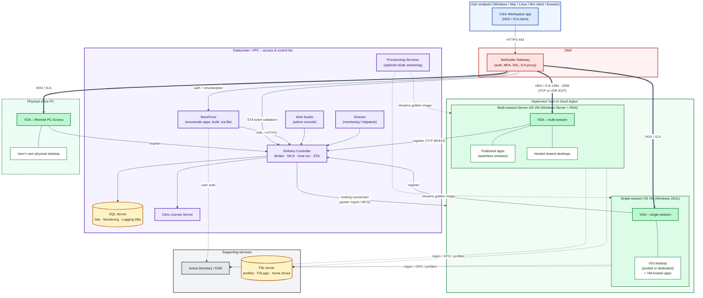
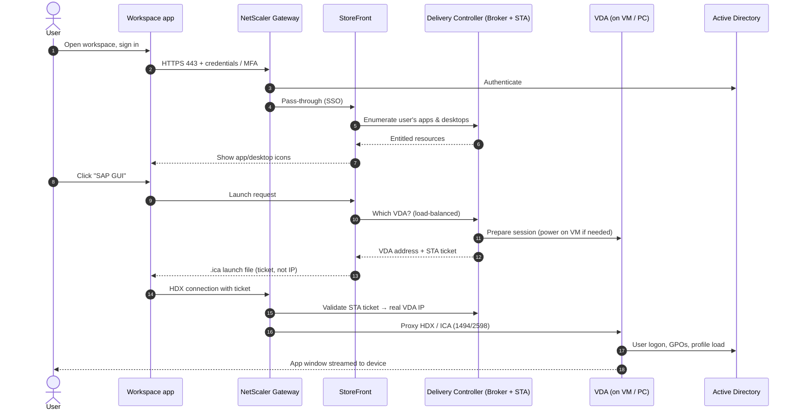
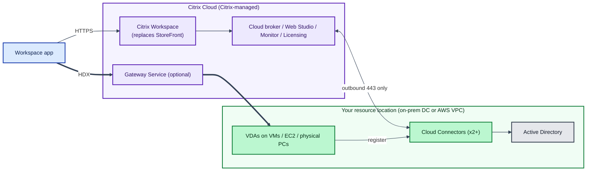

# Citrix – Overview, Delivery Patterns and Architecture

## What is Citrix?

Citrix is a virtualization and remote-delivery platform. Applications and desktops run on servers or virtual machines in a datacenter or cloud. Only screen updates, keyboard, mouse, audio, printing and USB redirection travel to the user's device, over Citrix's **HDX/ICA** protocol. Data stays central and the endpoint can be almost anything: a Windows laptop, Mac, Linux box, thin client, tablet or browser.

The core product, historically XenApp and XenDesktop, is now **Citrix Virtual Apps and Desktops** when you run it yourself, and **Citrix DaaS** when Citrix hosts the control plane in Citrix Cloud. The gateway product, once Citrix ADC or Citrix Gateway, is now branded **NetScaler** again. Product names have changed several times, so check current Citrix docs for exact SKUs.

## Usage (delivery) patterns

| Pattern | Where it runs | What the user sees | Typical use |
|---|---|---|---|
| **Published app** (hosted shared app) | Multi-session Windows Server VM (RDS host); many users share one VM | Only the app window, appearing "seamlessly" next to local apps | Line-of-business apps, ERP clients, apps that need to sit close to their database |
| **Hosted shared desktop** | Same multi-session Server OS VM | A full desktop, but shared with other users on that VM | Task workers, call centres; cheapest per user |
| **VDI (virtual desktop)** | Single-session Windows 10/11 VM, one user per VM | A full personal desktop | Knowledge workers, developers, admin rights or custom software |
| ↳ *Pooled / random (non-persistent)* | Reset at logoff, from a golden image | Same, but changes are discarded | Scale and easy patching |
| ↳ *Static / dedicated (persistent)* | Same VM every time, changes kept | Same, with changes kept | Power users |
| **VM-hosted app** | App published from a single-session VDI VM | Seamless app window | Apps that won't run on Windows Server or multi-session |
| **Remote PC Access** | The user's real physical office PC with a VDA installed | Their own physical desktop, remotely | Work from home without building VDI; GPU or special-hardware desks |

Related options include Citrix Secure Browser (a hosted, isolated browser), Local App Access, App Layering, and app streaming through App-V or MSIX app attach. All of these build on the same core components.

## Components

**User / edge**

- **Citrix Workspace app**: the client (HDX receiver) on the endpoint.
- **NetScaler Gateway**: sits in the DMZ. It handles authentication, MFA and SSL termination, and acts as an ICA proxy so external users never connect directly to internal VMs.

**Access & control plane**

- **StoreFront**: the web or store service that lists the apps and desktops a user is entitled to and generates the launch (`.ica`) file. In DaaS this role is played by Citrix Workspace in the cloud.
- **Delivery Controller (DDC)**: the brain. It runs the Broker service (which VDA gets the session), Machine Creation Services, the Host service (power control of VMs via the hypervisor or cloud API), and the Secure Ticket Authority (STA).
- **SQL Server**: holds the Site, Monitoring and Configuration Logging databases.
- **License Server**: issues Citrix licences.
- **Studio / Web Studio**: the admin console. **Director**: monitoring and helpdesk console.
- **Cloud Connector**: used only with DaaS. It replaces the on-prem DDC and StoreFront link to Citrix Cloud.

**Image & workload**

- **VDA (Virtual Delivery Agent)**: installed *inside* every machine that delivers sessions. It registers with the DDC and serves HDX sessions. It comes in three variants: multi-session (Server OS), single-session (desktop OS), and Remote PC Access.
- **Provisioning Services (PVS)** or **MCS**: build or stream VMs from one golden image.
- **Hypervisor / cloud**: vSphere, Hyper-V, XenServer, Nutanix AHV, AWS EC2 or Azure, reached through a "hosting connection."

**Supporting**

- Active Directory and DNS.
- File servers for user profiles (Citrix Profile Management or FSLogix).
- Optional extras: Workspace Environment Management (WEM), Federated Authentication Service, and Session Recording.

## Architecture diagram (on-prem / self-managed)

**How to read it:** thick arrows (`==>`) are the actual screen and keyboard session traffic. Thin arrows are control and brokering traffic. Dotted arrows are image, identity and profile dependencies. Internal users on the corporate network usually skip the Gateway and go straight from Workspace app to StoreFront, then directly to the VDA.

**Colour key**

| Colour | What it marks |
|---|---|
| Blue | Endpoint / client |
| Red | DMZ / gateway |
| Purple | Citrix control plane |
| Amber | Data stores |
| Grey | Directory services |
| Green | VDAs and the workloads they host. The physical PC zone has a dashed border to show it isn't a VM. |

## Launch sequence (what happens when a user clicks an app)

## Citrix DaaS (cloud-managed) variant

With DaaS, StoreFront (replaced by Workspace), the Delivery Controller, SQL, Studio, Director and licensing all move into Citrix Cloud. You run only the **Cloud Connectors**, at least two per resource location, plus the **VDAs** and AD. A NetScaler Gateway can also be swapped for the Citrix-hosted Gateway Service.

For an AWS-based setup, this is the common shape: the VDAs and Cloud Connectors run on EC2 inside your VPC, and the hosting connection uses the AWS API to power instances on and off.
