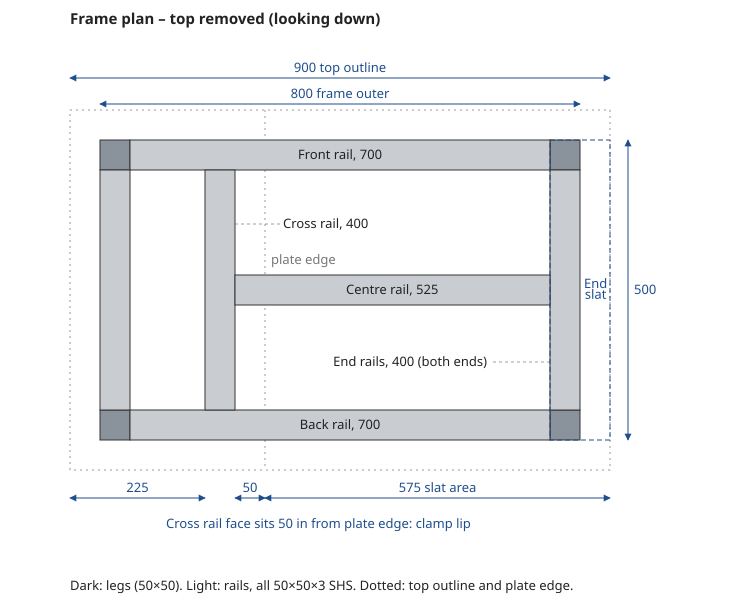
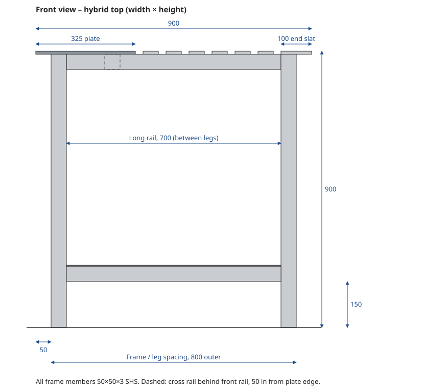
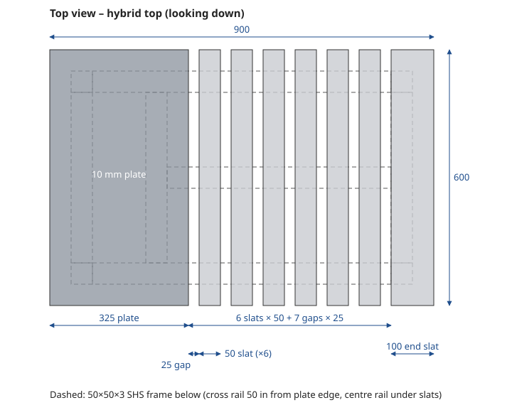
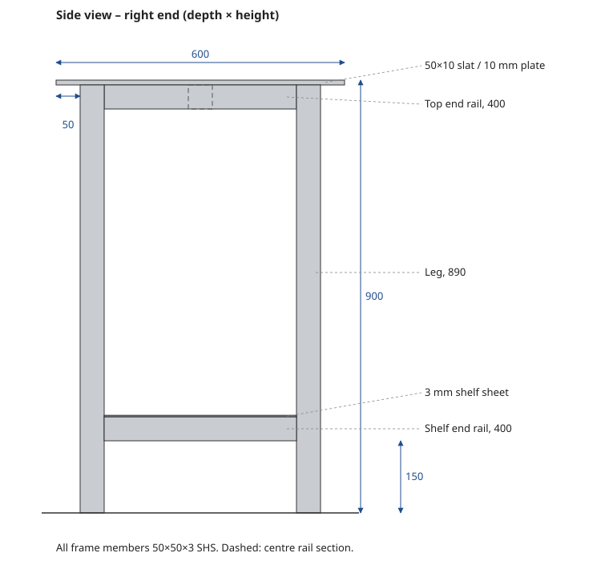

# Small Welding Table – Design, Cut List and Build Notes

> **Status:** Design · **Date:** 2026-10-28 · **Units:** millimetres
> **Size:** 900 × 600 mm top, ~900 mm working height, ~80–90 kg all-up

## 1. Purpose

A compact, rigid welding and fabrication table that fits a single-car garage, built entirely from standard Australian steel sections. Two top options are covered: a full solid plate, and a hybrid plate + slat top (recommended) that gives clamp access anywhere on the table.

## 2. Overall design

```
            900
 |<------------------------>|
 +==========================+  <- 10 mm top (50 mm overhang all round)
   [______________________]    <- 50×50×3 SHS top frame
   ||                    ||
   ||                    ||    <- 50×50×3 SHS legs (4 × 890)
   ||                    ||
   ||====================||    <- shelf frame + 3 mm sheet, 150 mm off floor
   ||                    ||
 ----------------------------  floor           height ~900
```

| Item | Value |
|---|---|
| Top | 900 × 600 mm |
| Working height | ~900 mm (set just below belt line) |
| Frame | 50×50×3 SHS, 800 × 500 mm outer (inset 50 mm under the top) |
| Shelf | 150 mm above the floor |
| Weight | ~90 kg (solid plate) / ~81 kg (hybrid) |

## 3. Top options

### 3.1 Option A – solid plate

- 1 × 900 × 600 × 10 mm plate (12 mm resists warping better if budget allows)
- Simplest build, best heat sink, nothing falls through
- Clamping only at the 50 mm overhang unless a hole grid is added

### 3.2 Option B – slats only

- 13 × 600 mm lengths of 50×10 flat bar, laid flat, running front to back
- 20 mm gaps (13 × 50 + 12 × 20 = 890 mm)
- Needs a centre rail so slats don't flex under hammering

| Pros | Cons |
|---|---|
| Clamp through the gaps anywhere | Small parts and nuts fall through |
| Spatter and slag fall through | Harder to keep perfectly flat |
| Lighter and usually cheaper than plate | Less mass to absorb heat and hammer blows |
| Damaged slats replaced individually | Every slat needs good frame contact for earthing |

### 3.3 Option C – hybrid (recommended)

Solid plate over the left 325 mm for small parts and layout work, slats over the remaining 575 mm for clamping. The right-hand end slat is 100 mm wide so it sits fully on the end rail and still overhangs 50 mm for clamping.

**Top layout (left to right):**
`325 plate → 25 gap → 50 slat → … (6 × 50 slats) → 25 gap → 100 end slat`
Check: 325 + 7 × 25 + 6 × 50 + 100 = 900 mm.
The end slat spans 800–900 mm: its inner 50 mm sits on the right end rail and the outer 50 mm is the clamping overhang.

#### Frame plan (top removed)

The bare frame from above, with the top outline and plate edge dotted for reference. The cross rail's right face sits 50 mm in from the plate edge, and the dashed outline at the right shows where the 100 mm end slat sits over the end rail.



#### Front view

Viewed from the front. The plate and slat ends sit on the 700 mm long rail, which fits between the legs. The dashed square is the cross rail, set 50 mm in from the plate's edge.



#### Top view

The slats run front to back. Dashed lines show the SHS frame below. The cross rail sits under the plate, 50 mm in from its right edge, so that edge has a clamping lip and the gap to the first slat stays open. The centre rail runs from the cross rail under all the slats, so each slat is supported in three places.



#### Side view

Viewed from the right end. The legs run full height to the underside of the top (890 mm), with the 400 mm end rails fitted between them. The dashed square is the end of the centre rail.



## 4. Cut list (hybrid top)

### 4.1 50×50×3 SHS

| Part | Qty | Length (mm) | Notes |
|---|---|---|---|
| Legs | 4 | 890 | Subtract caster height if fitting wheels |
| Top long rails (front/back) | 2 | 700 | Fitted between legs |
| Top end rails | 2 | 400 | Fitted between legs |
| Cross rail under plate | 1 | 400 | Right face 275 mm from the top's left edge (50 mm in from the plate edge) |
| Centre rail under slats | 1 | 525 | From cross rail to right end rail |
| Shelf long rails | 2 | 700 | Fitted between legs |
| Shelf end rails | 2 | 400 | Fitted between legs |

Total ≈ 8.9 m → buy two 8 m lengths. Legs run full height to the underside of the top; every rail fits between them. Use offcuts for the ground tab and a clamp rack.

### 4.2 Top and shelf

| Part | Qty | Size (mm) |
|---|---|---|
| Plate | 1 | 325 × 600 × 10 |
| Slats (50×10 flat bar) | 6 | 600 long (3.6 m, from one 6 m length) |
| End slat (100×10 flat bar) | 1 | 600 long |
| Shelf sheet | 1 | 800 × 500 × 3 with 50 × 50 corner notches for the legs (or expanded mesh) |

### 4.3 Fixings

- **Slats, bolted:** M10 × 70 countersunk bolts through both SHS walls with nylocs, 3 per slat (21 total); bolt the end slat into the end rail. 3 mm SHS wall is too thin to tap for M10.
- **Slats, welded:** stitch weld at the front and back rails only, so they can be ground off and replaced.
- **Plate:** plug weld or stitch weld; it doesn't need replacing.

### 4.4 Approximate weights

| Item | kg |
|---|---|
| SHS (8.89 m × 4.25 kg/m) | 38 |
| Plate 325 × 600 × 10 | 15 |
| Slats (3.6 m × 3.93 kg/m + 0.6 m × 7.85 kg/m) | 19 |
| Shelf 3 mm sheet | 9 |
| **Total** | **~81** |

## 5. Clamping provisions

**Built in**

- **50 mm overhang on all sides** – F-clamps, C-clamps and locking-jaw clamps grab the lip anywhere around the edge.
- **Slat gaps** (Options B/C) – clamp through the top anywhere over the slatted section.
- **Plate inner edge** (Option C) – the cross rail sits 50 mm in from the plate edge, giving a clamp lip there and keeping the plate-to-slat gap clear.
- **Optional 16 mm hole grid** on 100 mm centres in the plate – for fixture clamps, stop pins and hold-downs. Cut before assembly and keep holes clear of rails.
- **Legs and shelf rail** – somewhere to clamp long stock vertically or brace a job.

**Easy additions**

- **Vise** on a 10 mm plate bracket off a corner leg, sitting beyond the table edge.
- **Clamp rack** – angle or flat bar welded to the end of the frame with slots or pegs.
- **Edge slots** – 20 × 60 mm slots near the plate edge for mid-table clamping without a full grid.
- **Welding magnets** – the steel top holds parts at 45° and 90°.

> Keep the 50 mm overhang zone clear of brackets underneath – anything there blocks clamp jaws.

## 6. Build sequence and tips

1. Tack the top and shelf frames on a flat floor; check square by measuring diagonals.
2. Tack the legs on, then final weld in short alternating stitches, swapping corners, so the frame doesn't pull out of square.
3. Fit the plate and slats; check flush with a straightedge. Shim low slats with thin sheet rather than grinding the plate.
4. Fix the plate (plug or stitch welds) and slats (bolts or end stitches).
5. Weld a ground tab (flat bar offcut) to a leg for a reliable earth clamp point.
6. Options: two locking 100 mm casters (each rated 100 kg+) on one end, levelling feet on the other.

## 7. Glossary

| Term | Meaning |
|---|---|
| **SHS** | Square hollow section – square steel tube. `50×50×3` = 50 mm sides, 3 mm wall. Sold in 8 m lengths in Australia. |
| **RHS** | Rectangular hollow section – rectangular tube, e.g. `75×50×3`. |
| **Flat bar** | Solid rectangular bar, e.g. `50×10` = 50 mm wide, 10 mm thick. |
| **Stitch weld** | Short welds spaced along a joint (e.g. 25–40 mm every ~150 mm) instead of one continuous bead. Less heat, less warping. Skip around the job to spread heat. |
| **Plug weld** | Weld through a drilled hole (~10–12 mm) in the top piece, fusing it to the piece below. Ground flush, it leaves a smooth top with no edge beads. |
| **Nyloc** | Nylon-insert lock nut that resists vibrating loose. |

## 8. Suppliers near Rothwell QLD

| Supplier | Location | Notes | Phone |
|---|---|---|---|
| Metro Steel | 109 Kabi Cct, Deception Bay | Closest; odd sizes and cheap offcuts. Mon–Fri 7am–4pm | 07 3204 1000 |
| True Metal Solutions | 594 Old Gympie Rd, Narangba | Cut to length, offcut area, profile cutting. Open Sat 8am–12pm | 07 3888 0176 |
| Bits of Steel Supplies | 1 Maxwell St, Brendale | Online ordering, drilling service, delivery | 07 3865 7740 |
| The Steel Market | 61 Griffin Cres, Brendale | Retail steel | 1300 400 876 |

Call ahead to confirm 10 mm plate and 50×10 and 100×10 flat bar are in stock, whether they'll cut to the list, and ask about offcuts.
