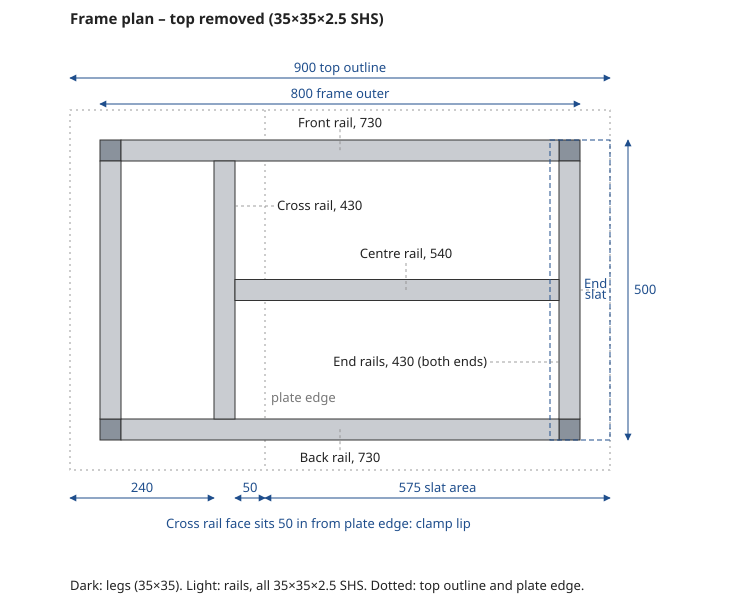
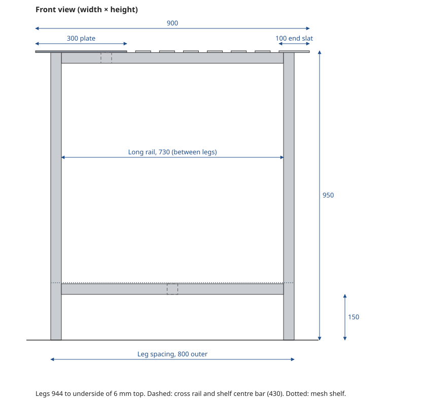
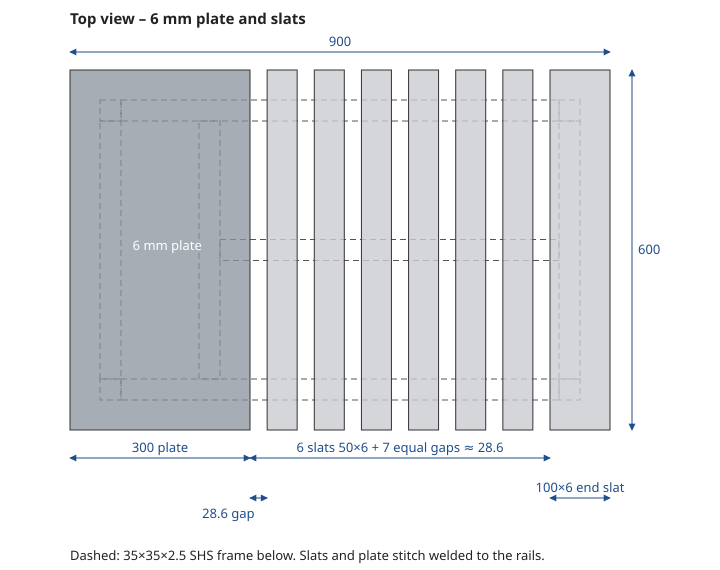
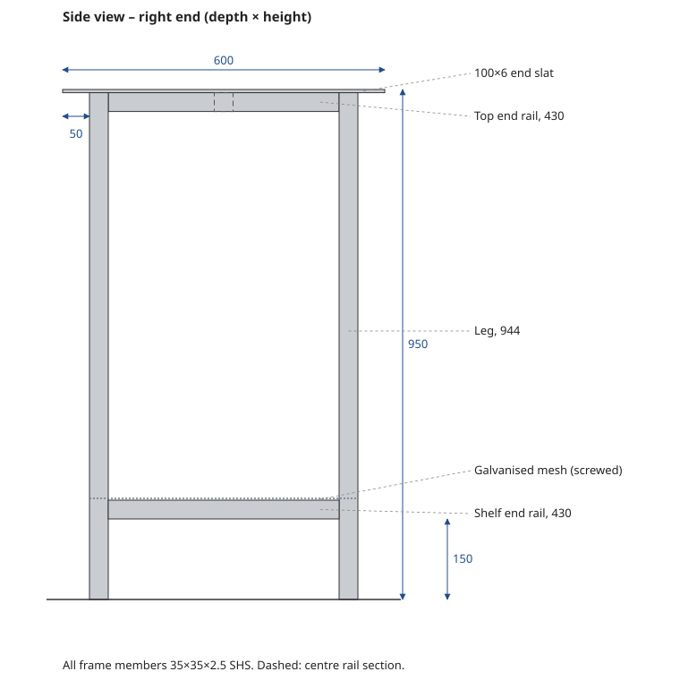

# Small Welding Table – Final Design, Cut List and Build Notes

> **Status:** Final · **Date:** 2026-11-02 · **Units:** millimetres
> **Size:** 900 × 600 mm top, 950 mm working height, ~44 kg of steel plus mesh

## 1. Purpose

A compact welding table for a single-car garage, built from standard Australian steel sections. It is for **welding only**: hammering, straightening and other heavy work are done on a separate bench. The top combines a solid plate for small parts and layout with slats for clamping anywhere.

## 2. Specification

| Item | Value |
|---|---|
| Top | 900 × 600 mm: 325 mm of 6 mm plate, then 50×6 slats and a 100×6 end slat |
| Working height | 950 mm (sized for a 181 cm user; elbow height less ~180 mm) |
| Frame | 35×35×2.5 SHS, painted, 800 × 500 mm outer, inset 50 mm under the top |
| Shelf | Galvanised mesh on a 35×35 shelf frame, 150 mm above the floor |
| Fixing | Top stitch welded to the frame; mesh screwed down |
| Steel weight | ~44 kg plus mesh |

**Limits**

- Not for hammering, straightening or heavy loads; the frame flexes and the top dents.
- The 6 mm top can warp under heat if welds are concentrated (see build notes).
- The mesh shelf is for light items such as clamps, gloves, wire and hand tools.
- With a mesh shelf there's no welded panel bracing the frame. Add the optional diagonal brace if it sways.

## 3. Layout

**Top (left to right):** `325 plate → 25 gap → 6 × 50 slats with 25 mm gaps → 25 gap → 100 end slat`
Check: 325 + 7 × 25 + 6 × 50 + 100 = 900 mm.

**Frame**

- Legs run full height (944 mm) to the underside of the 6 mm top; every rail fits between them.
- Top frame: 730 mm front and back rails, 430 mm end rails.
- Cross rail under the plate at 240–275 mm from the top's left edge, so its face is 50 mm in from the plate edge. This gives the plate's inner edge a clamping lip and keeps the plate-to-slat gap clear.
- Centre rail from the cross rail to the right end rail, centred front to back. Each slat is supported at the front, centre and back; the longest unsupported span is about 198 mm.
- The 100 mm end slat rests on the right end rail for its full depth (35 mm of bearing) and on the ends of the front, back and centre rails. Its outer 50 mm is the clamping overhang.
- Shelf frame: 730 mm long rails and 430 mm end rails with their bottom face 150 mm off the floor, plus a 430 mm centre bar front to back to support the mesh.

### Frame plan (top removed)



### Front view



### Top view



### Side view



## 4. Cut list

### 4.1 35×35×2.5 SHS (painted, not galvanised)

| Part | Qty | Length (mm) | Notes |
|---|---|---|---|
| Legs | 4 | 944 | To the underside of the 6 mm top. Subtract caster or foot height if fitted |
| Long rails (top front/back, shelf front/back) | 4 | 730 | Fitted between legs |
| Short rails (top ends, cross rail, shelf ends, shelf centre bar) | 6 | 430 | Cross rail's right face 275 mm from the top's left edge |
| Centre rail under slats | 1 | 540 | Centred front to back, cross rail to right end rail |
| Diagonal brace (optional) | 1 | ~1,050 | Cut to fit on assembly, only if the frame sways |

**Order:** 4 @ 944, 4 @ 730, 6 @ 430, 1 @ 540 (15 pieces, 9,816 mm), plus the optional brace.

### 4.2 Top and shelf

| Part | Qty | Size (mm) |
|---|---|---|
| HR plate, 6 mm | 1 | 600 × 325 |
| Flat bar 50×6 (slats) | 6 | 600 long |
| Flat bar 100×6 (end slat) | 1 | 600 long |
| Galvanised welded mesh, ~4 mm wire, 50 × 50 mm aperture | 1 | 800 × 500, with a 35 × 35 notch at each corner |

### 4.3 Hardware and consumables

| Item | Qty |
|---|---|
| Self-drilling (tek) screws with washers, for the mesh | ~20 |
| 35×35 plastic end caps or levelling feet | 4 |
| Welding wire or rods, cutting and flap discs | As needed |
| Antispatter spray, and paint to touch up welds | As needed |

### 4.4 Approximate weights

| Item | kg |
|---|---|
| SHS (9.82 m × 2.42 kg/m) | 23.8 |
| Plate 600 × 325 × 6 | 9.2 |
| Slats (3.6 m × 2.36 kg/m) | 8.5 |
| End slat (0.6 m × 4.71 kg/m) | 2.8 |
| **Total (excluding mesh)** | **~44** |

### 4.5 Email-ready materials list

```
Materials and cut list – welding table

1. SHS 35x35x2.5 mm, painted
   Cuts: 4 @ 944 mm, 4 @ 730 mm, 6 @ 430 mm, 1 @ 540 mm
   (15 pieces, 9,816 mm total)
   Optional brace: 1 @ 1,050 mm

2. HR plate, 6 mm
   Cut panel: 1 @ 600 x 325 mm

3. Flat bar, 50x6 mm
   Cuts: 6 @ 600 mm

4. Flat bar, 100x6 mm
   Cuts: 1 @ 600 mm

5. Galvanised welded mesh, approx. 4 mm wire, 50 x 50 mm aperture
   Cut panel: 1 @ 800 x 500 mm, with 35 x 35 mm notch at each corner

Hardware
6. Self-drilling (tek) screws with washers: approx. 20
7. 35x35 mm plastic end caps or levelling feet: 4
```

## 5. Clamping provisions

- **50 mm overhang on all four sides:** F-clamps, C-clamps and locking-jaw clamps grab the lip anywhere around the edge.
- **Slat gaps:** clamp through the top anywhere over the slatted section.
- **Plate inner edge:** the cross rail sits 50 mm in, so the edge facing the slats is a clamping lip, except where the front, back and centre rails pass under it.
- **Legs and shelf rails:** somewhere to clamp long stock vertically.
- **Easy additions:** welding magnets for holding parts at 45° and 90°, and edge slots in the plate for mid-table clamping.

> Keep the 50 mm overhang zone clear of brackets underneath; anything there blocks clamp jaws.

## 6. Build sequence

1. **Prepare:** grind the paint off the tube ends and joint areas. Cut the mesh corner notches with an angle grinder if the supplier hasn't.
2. **Top frame:** lay out the front, back and end rails between the four leg tops on a flat floor, upside down. Tack, then check square by measuring the diagonals.
3. **Inner rails:** tack in the cross rail (right face 275 mm from the top's left edge, i.e. 225 mm from the frame's left outer face) and the centre rail.
4. **Shelf frame:** stand the frame up and tack the shelf rails between the legs with their bottom face 150 mm off the floor, then the shelf centre bar across the middle. Recheck square and that the legs are plumb.
5. **Final weld the frame:** short stitches, swapping corners so it doesn't pull out of square. 2.5 mm wall can burn through, so keep the current moderate and aim at the thicker part of each joint.
6. **Fit the top:** lay the plate and slats in place with 25 mm spacers between them. Check flush with a straightedge, then stitch weld 20–25 mm every 100–150 mm, skipping around the table to spread the heat.
7. **Finish:** clean up, paint the welds, fit the end caps or feet.
8. **Shelf mesh:** after all welding is done, screw the mesh to the shelf rails and centre bar about every 150 mm. Never weld galvanised steel; heated zinc gives off harmful fumes.
9. **Check for sway:** push the top sideways. If it racks, fit the diagonal brace across the back, from the top of one leg to the far end of the back shelf rail.

## 7. Glossary

| Term | Meaning |
|---|---|
| **SHS** | Square hollow section – square steel tube. `35×35×2.5` = 35 mm sides, 2.5 mm wall. |
| **Flat bar** | Solid rectangular bar, e.g. `50×6` = 50 mm wide, 6 mm thick. |
| **HR** | Hot rolled – standard mild steel plate and sheet, with a dark grey mill-scale finish. |
| **Galvanised** | Steel with a zinc coating. Don't weld it: heated zinc gives off harmful fumes. |
| **Stitch weld** | Short welds spaced along a joint instead of one continuous bead. Less heat, less warping. |
| **Racking** | A frame twisting or leaning out of square when pushed sideways. |
| **Tek screw** | Self-drilling screw that drills its own hole in steel. |

## 8. Suppliers near Rothwell QLD

| Supplier | Location | Notes | Phone |
|---|---|---|---|
| Bits of Steel Supplies | 1 Maxwell St, Brendale | Online catalogue lists 35×35×2.5 SHS, 50×6 and 100×6 flat bar and 6 mm HR plate; cuts to length and to size; online ordering | 07 3865 7740 |
| Metro Steel | 109 Kabi Cct, Deception Bay | Closest; sells hollow sections, flat bar, plate and galvanised mesh; does cutting; sizes not published. Mon–Fri 7am–4pm | 07 3204 1000 |
| True Metal Solutions | 594 Old Gympie Rd, Narangba | Flat bar in 6 m or 4 m lengths or cut to size; plate cut to size; open Sat 8am–12pm | 07 3888 0176 |

Catalogue listings show what a supplier carries, not live stock, so call ahead to confirm.
