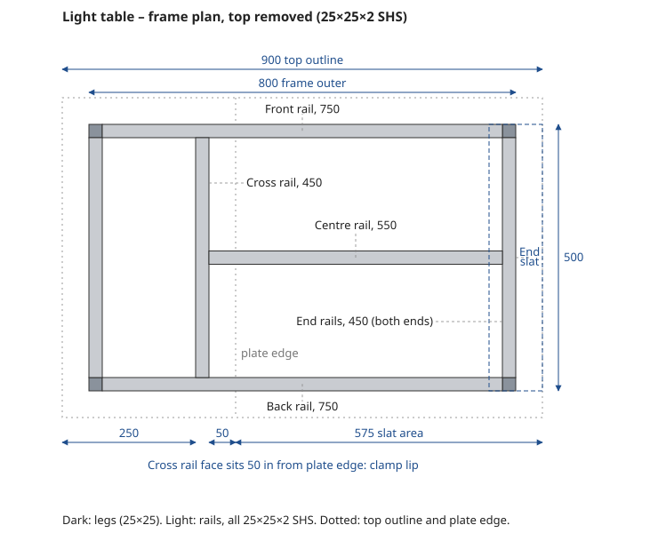
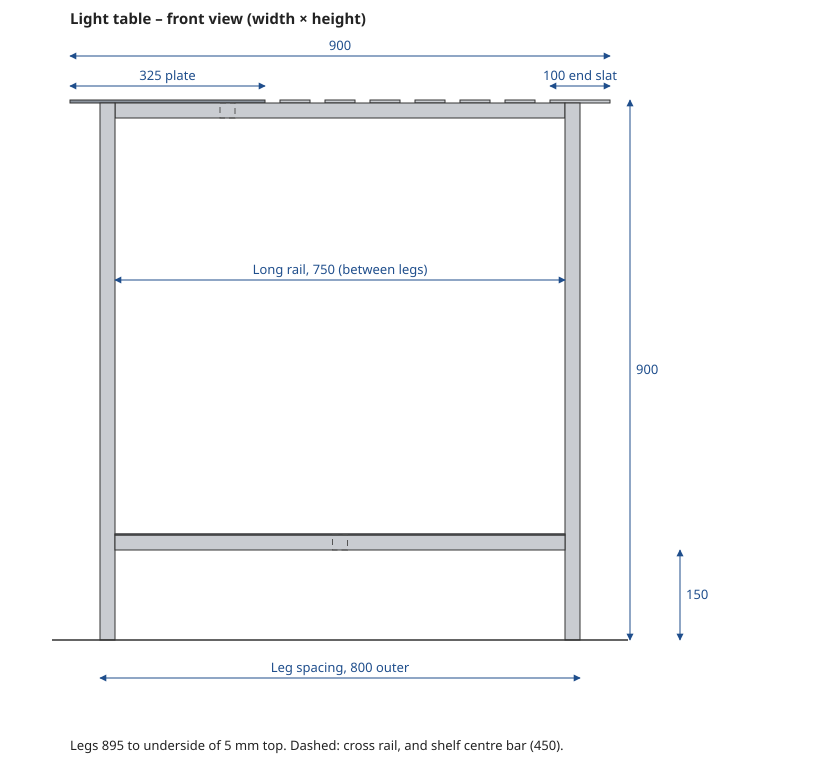
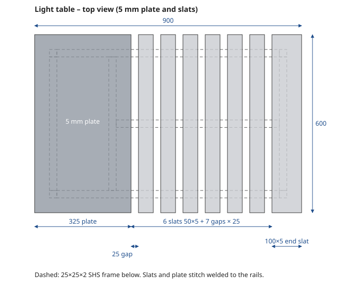
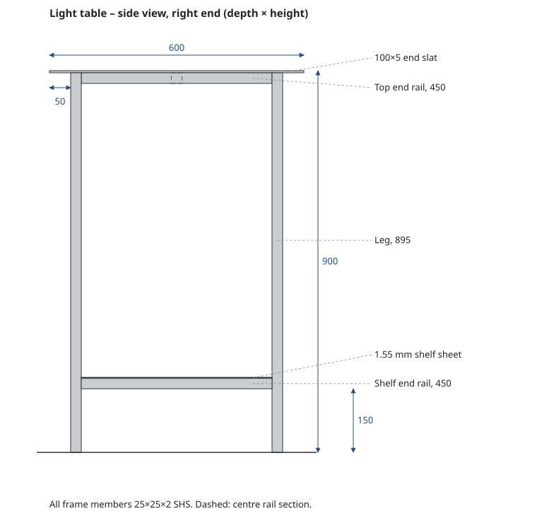

# Small Welding Table – Design, Cut List and Build Notes

> **Status:** Design · **Date:** 2026-10-28 · **Units:** millimetres
> **Size:** 900 × 600 mm top, ~900 mm working height, ~35 kg (light) to ~90 kg (solid plate) of steel

## 1. Purpose

A compact, rigid welding and fabrication table that fits a single-car garage, built entirely from standard Australian steel sections. Three top options are covered: a full solid plate, slats only, and a hybrid plate + slat top (recommended) that gives clamp access anywhere on the table. Section 5 adds a **light table option**: the same hybrid layout in thinner sections, for welding only, at well under half the steel.

## 2. Overall design

```
            900
 |<------------------------>|
 +==========================+  <- 10 mm top (50 mm overhang all round)
   [______________________]    <- 50×50×3 SHS top frame
   ||                    ||
   ||                    ||    <- 50×50×3 SHS legs (4 × 890)
   ||                    ||
   ||====================||    <- shelf frame + 3 mm sheet, 150 mm off floor
   ||                    ||
 ----------------------------  floor           height ~900
```

| Item | Value |
|---|---|
| Top | 900 × 600 mm |
| Working height | ~900 mm (set just below belt line) |
| Frame | 50×50×3 SHS (light option: 25×25×2), 800 × 500 mm outer (inset 50 mm under the top) |
| Shelf | 150 mm above the floor |
| Weight | ~90 kg (solid plate) / ~82 kg (hybrid) / ~35 kg (light option) |

## 3. Top options

### 3.1 Option A – solid plate

- 1 × 900 × 600 × 10 mm plate (12 mm resists warping better if budget allows)
- Simplest build, best heat sink, nothing falls through
- Clamping only at the 50 mm overhang unless a hole grid is added

### 3.2 Option B – slats only

- 9 × 600 mm lengths of 50×10 flat bar plus 2 × 600 mm of 100×10 flat bar for the end slats, laid flat, running front to back
- Layout: `100 end slat → 25 gap → 50 slat → … (9 × 50 slats) → 25 gap → 100 end slat` = 100 + 10 × 25 + 9 × 50 + 100 = 900 mm
- Each 100 mm end slat sits half on an end rail and half as the 50 mm clamping overhang. Narrow slats at the ends would sit outside the frame with nothing under them.
- Needs a 700 mm centre rail between the end rails so slats don't flex under hammering

| Pros | Cons |
|---|---|
| Clamp through the gaps anywhere | Small parts and nuts fall through |
| Spatter and slag fall through | Harder to keep perfectly flat |
| Lighter and usually cheaper than plate | Less mass to absorb heat and hammer blows |
| Damaged slats replaced individually | Every slat needs good frame contact for earthing |

### 3.3 Option C – hybrid (recommended)

Solid plate over the left 325 mm for small parts and layout work, slats over the remaining 575 mm for clamping. The right-hand end slat is 100 mm wide so it sits fully on the end rail and still overhangs 50 mm for clamping.

**Top layout (left to right):**
`325 plate → 25 gap → 50 slat → … (6 × 50 slats) → 25 gap → 100 end slat`
Check: 325 + 7 × 25 + 6 × 50 + 100 = 900 mm.
The end slat spans 800–900 mm: its inner 50 mm sits on the right end rail and the outer 50 mm is the clamping overhang.

> Note: the clamping lip along the plate's inner edge is clear for most of its length, but the front, back and centre rails all pass under it, so there's no clamp access at those three 50 mm spots.

#### Frame plan (top removed)

The bare frame from above, with the top outline and plate edge dotted for reference. The cross rail's right face sits 50 mm in from the plate edge, and the dashed outline at the right shows where the 100 mm end slat sits over the end rail.


#### Front view

Viewed from the front. The plate and slat ends sit on the 700 mm long rail, which fits between the legs. The dashed square is the cross rail, set 50 mm in from the plate's edge.


#### Top view

The slats run front to back. Dashed lines show the SHS frame below. The cross rail sits under the plate, 50 mm in from its right edge, so that edge has a clamping lip and the gap to the first slat stays open. The centre rail runs from the cross rail under all the slats, so each slat is supported in three places.


#### Side view

Viewed from the right end. The legs run full height to the underside of the top (890 mm), with the 400 mm end rails fitted between them. The dashed square is the end of the centre rail.


## 4. Cut list – standard hybrid table

### 4.1 50×50×3 SHS

| Part | Qty | Length (mm) | Notes |
|---|---|---|---|
| Legs | 4 | 890 | Subtract caster height if fitting wheels |
| Top long rails (front/back) | 2 | 700 | Fitted between legs |
| Top end rails | 2 | 400 | Fitted between legs |
| Cross rail under plate | 1 | 400 | Right face 275 mm from the top's left edge (50 mm in from the plate edge) |
| Centre rail under slats | 1 | 525 | From cross rail to right end rail |
| Shelf long rails | 2 | 700 | Fitted between legs |
| Shelf end rails | 2 | 400 | Fitted between legs |

Total = 8,885 mm. Legs run full height to the underside of the top; every rail fits between them.

**Buying:** one 8 m length covers the 4 legs, 4 × 700, the 525 and 2 × 400 (7,718 mm with 3 mm saw kerfs, ~280 mm left over). The remaining 3 × 400 (1,209 mm) come from a second length or an offcut. Cheapest is usually to have the supplier cut the whole list from stock, or ask for 50×50×3 offcuts for the three 400s. Use leftovers for the ground tab and a clamp rack.

**Casters:** if fitting casters, shorten all four legs by the caster's overall height (e.g. a 100 mm caster is typically ~125 mm overall, giving 765 mm legs).

### 4.2 Top and shelf

| Part | Qty | Size (mm) |
|---|---|---|
| Plate | 1 | 325 × 600 × 10 |
| Slats (50×10 flat bar) | 6 | 600 long (3.6 m, from one 6 m length) |
| End slat (100×10 flat bar) | 1 | 600 long |
| Shelf sheet | 1 | 800 × 500 × 3 with 50 × 50 corner notches for the legs (or expanded mesh) |

The 3 mm sheet spans 700 × 400 between the shelf rails, which is fine for clamps and tools. For heavy storage (gas bottles, a vise), add a 400 mm SHS bar across the middle of the shelf frame.

### 4.3 Fixings

- **Slats, bolted:** M10 × 80 countersunk bolts through both SHS walls with a washer and nyloc. A 70 mm bolt is too short: 10 mm slat + 50 mm SHS + washer + nyloc needs about 74 mm, 3 per slat (21 total); bolt the end slat into the end rail. 3 mm SHS wall is too thin to tap for M10.
- **Slats, welded:** stitch weld at the front and back rails only, so they can be ground off and replaced.
- **Plate:** plug weld or stitch weld; it doesn't need replacing.

### 4.4 Approximate weights

| Item | kg |
|---|---|
| SHS (8.89 m × 4.25 kg/m) | 38 |
| Plate 325 × 600 × 10 (78.5 kg/m²) | 15 |
| Slats (3.6 m × 4.02 kg/m + 0.6 m × 8.04 kg/m) | 19 |
| Shelf 3 mm sheet | 9 |
| **Total** | **~82** |

Section weights are from the Bits of Steel catalogue.

### 4.5 Shopping list and availability

Checked 28 Oct 2026 against supplier websites. Catalogue listings show what a supplier carries, not live stock, so call ahead.

| Item | Quantity | Bits of Steel (Brendale) | Metro Steel / True Metal |
|---|---|---|---|
| 50×50×3 SHS (painted) | 8.9 m cut to list | Listed (4.25 kg/m); cut-to-length service | Hollow sections and cutting offered; size not published |
| 50×10 flat bar | 6 × 600 mm (3.6 m) | Listed (4.02 kg/m) | Flat bar offered (True Metal: 6 m or 4 m lengths, or cut to size); sizes not published |
| 100×10 flat bar | 1 × 600 mm | Listed (8.04 kg/m) | As above |
| 10 mm HR plate | 325 × 600 mm | Listed; custom panels cut to size | Plate offered; True Metal cuts to size and has HD plasma cutting |
| 3 mm HR sheet | 800 × 500 mm | Listed; guillotined to size | Sheet offered; thickness not published |
| M10 × 80 countersunk bolts, washers, nylocs | 21 each | Not a fastener supplier – use a bolt or hardware shop | – |

Bits of Steel is the only one that publishes every size, and it takes cut lists online. That makes it the easiest single order.

## 5. Light table option (welding only)

For a table used only for welding, with hammering, straightening and other heavy work done on a separate bench. It keeps the hybrid's 900 × 600 top layout, 900 mm height and clamping lips, built from lighter, cheaper sections.

| | Standard hybrid | Light option |
|---|---|---|
| Frame | 50×50×3 SHS | 25×25×2.0 SHS |
| Plate | 325 × 600 × 10 | 325 × 600 × 5 |
| Slats | 6 × 50×10, 1 × 100×10 end slat | 6 × 50×5, 1 × 100×5 end slat |
| Shelf | 3 mm HR sheet | 1.55 mm HR sheet + centre bar |
| Fixing the top | Bolts or stitch welds | Stitch welds only |
| Steel weight | ~82 kg | ~35 kg |

**Limits of the light option**

- Not for hammering, straightening or heavy loads; the frame flexes and the top dents.
- The 5 mm top warps more easily under heat (see build notes).
- The shelf is for light items such as clamps, gloves, wire and hand tools.
- The lighter frame racks (sways out of square) more when pushed; welding the shelf sheet down all round stiffens it.

### 5.1 Layout

The top layout is unchanged: `325 plate → 25 gap → 6 × 50 slats with 25 gaps → 25 gap → 100 end slat`. Because the legs are 25 mm instead of 50, the frame changes:

- Rails fitted between the legs are longer: 750 mm long rails and 450 mm end rails.
- The cross rail sits at 250–275 mm from the top's left edge, so its face is still 50 mm in from the plate edge.
- The centre rail runs from the cross rail to the right end rail, centred front to back. The longest unsupported slat span is about 212 mm.
- The 100 mm end slat rests on the right end rail for its full depth and on the ends of the front, back and centre rails. Its outer 50 mm is the clamping overhang.
- The shelf has a 450 mm centre bar across the middle, front to back, to stop the thin sheet sagging.

#### Frame plan (top removed)



#### Front view



#### Top view



#### Side view



### 5.2 Cut list – light option

**25×25×2.0 SHS (painted, not galvanised)**

| Part | Qty | Length (mm) | Notes |
|---|---|---|---|
| Legs | 4 | 895 | To the underside of the 5 mm top. Subtract caster height if fitting wheels |
| Top long rails (front/back) | 2 | 750 | Fitted between legs |
| Top end rails | 2 | 450 | Fitted between legs |
| Cross rail under plate | 1 | 450 | Right face 275 mm from the top's left edge (50 mm in from the plate edge) |
| Centre rail under slats | 1 | 550 | Centred front to back, from cross rail to right end rail |
| Shelf long rails | 2 | 750 | Fitted between legs, bottom face 150 mm off the floor |
| Shelf end rails | 2 | 450 | Fitted between legs |
| Shelf centre bar | 1 | 450 | Across the middle of the shelf frame, front to back |

Total = 9,830 mm. From 6.5 m stock this is two lengths (one carries the legs, three long rails and the centre rail; the other the remaining rails). From 8 m stock it's one length plus five 450 mm pieces from an offcut. Simplest is to have the supplier cut the list.

**Top and shelf**

| Part | Qty | Size (mm) |
|---|---|---|
| Plate (HR) | 1 | 325 × 600 × 5 |
| Slats (50×5 flat bar) | 6 | 600 long (3.6 m) |
| End slat (100×5 flat bar) | 1 | 600 long |
| Shelf sheet (1.55 mm HR) | 1 | 800 × 500 with 25 × 25 corner notches for the legs |

**Fixings:** none. The plate, slats and shelf sheet are all stitch welded. 5 mm flat bar is too thin for countersunk bolts, and 2 mm tube would crush under bolt tension.

**Approximate weights**

| Item | kg |
|---|---|
| SHS (9.83 m × 1.36 kg/m) | 13.4 |
| Plate 325 × 600 × 5 | 7.7 |
| Slats (3.6 m × 1.96 kg/m) | 7.1 |
| End slat (0.6 m × 3.93 kg/m) | 2.4 |
| Shelf sheet 1.55 mm | 4.8 |
| **Total** | **~35** |

### 5.3 Shopping list and availability – light option

Checked against the Bits of Steel online catalogue; listings show what's carried, not live stock, so call ahead.

| Item | Quantity | Bits of Steel (Brendale) |
|---|---|---|
| 25×25×2.0 SHS (painted) | 9.8 m cut to list | Listed (1.36 kg/m); cut-to-length service |
| 50×5 flat bar | 6 × 600 mm | Listed |
| 100×5 flat bar | 1 × 600 mm | Listed |
| 5 mm HR plate | 325 × 600 mm | Listed; custom panels cut to size |
| 1.55 mm HR sheet | 800 × 500 mm | Listed; guillotined to size |

Metro Steel and True Metal Solutions also sell hollow sections, flat bar, plate and sheet but don't publish sizes (see section 4.5).

### 5.4 Build notes – light option

- **Thin wall welding:** 2 mm tube burns through easily. Turn the current down, keep tacks and stitches short, and aim the arc at the thicker part of each joint.
- **Keep it square:** tack the whole frame first, check the diagonals, then weld in short stitches, swapping corners so it doesn't pull out of square.
- **Fixing the top:** stitch weld the plate and slats to the rails with 20–25 mm welds every 100–150 mm, skipping around the table to spread the heat. Check flatness with a straightedge as you go.
- **Shelf sheet:** tack every 100–150 mm all round and along the centre bar. Welded all round, it acts as bracing against racking.
- **No galvanised steel** in welded parts: the zinc coating gives off harmful fumes when heated. Use painted or black (uncoated) steel.
- **Looking after the top:** use antispatter spray, plasma cut over the slat gaps rather than on the plate, and avoid welding jigs or tabs straight onto the 5 mm top.
- **If it still sways:** add a diagonal brace from a leg to the shelf rail on the back, where it won't get in the way.

## 6. Clamping provisions

**Built in**

- **50 mm overhang on all sides** – F-clamps, C-clamps and locking-jaw clamps grab the lip anywhere around the edge.
- **Slat gaps** (Options B/C) – clamp through the top anywhere over the slatted section.
- **Plate inner edge** (Option C) – the cross rail sits 50 mm in from the plate edge, giving a clamp lip there and keeping the plate-to-slat gap clear.
- **Optional 16 mm hole grid** on 100 mm centres in the plate – for fixture clamps, stop pins and hold-downs. Cut before assembly and keep holes clear of rails.
- **Legs and shelf rail** – somewhere to clamp long stock vertically or brace a job.

**Easy additions**

- **Vise** on a 10 mm plate bracket off a corner leg, sitting beyond the table edge.
- **Clamp rack** – angle or flat bar welded to the end of the frame with slots or pegs.
- **Edge slots** – 20 × 60 mm slots near the plate edge for mid-table clamping without a full grid.
- **Welding magnets** – the steel top holds parts at 45° and 90°.

> Keep the 50 mm overhang zone clear of brackets underneath – anything there blocks clamp jaws.

## 7. Build sequence and tips

1. Tack the top and shelf frames on a flat floor; check square by measuring diagonals.
2. Tack the legs on, then final weld in short alternating stitches, swapping corners, so the frame doesn't pull out of square.
3. Fit the plate and slats; check flush with a straightedge. Shim low slats with thin sheet rather than grinding the plate.
4. Fix the plate (plug or stitch welds) and slats (bolts or end stitches).
5. Weld a ground tab (flat bar offcut) to a leg for a reliable earth clamp point.
6. Options: two locking 100 mm casters (each rated 100 kg+) on one end, levelling feet on the other.

## 8. Glossary

| Term | Meaning |
|---|---|
| **SHS** | Square hollow section – square steel tube. `50×50×3` = 50 mm sides, 3 mm wall. Sold in 8 m lengths in Australia. |
| **RHS** | Rectangular hollow section – rectangular tube, e.g. `75×50×3`. |
| **Flat bar** | Solid rectangular bar, e.g. `50×10` = 50 mm wide, 10 mm thick. |
| **Stitch weld** | Short welds spaced along a joint (e.g. 25–40 mm every ~150 mm) instead of one continuous bead. Less heat, less warping. Skip around the job to spread heat. |
| **Plug weld** | Weld through a drilled hole (~10–12 mm) in the top piece, fusing it to the piece below. Ground flush, it leaves a smooth top with no edge beads. |
| **Nyloc** | Nylon-insert lock nut that resists vibrating loose. |
| **HR** | Hot rolled – standard mild steel plate and sheet, with a dark grey mill-scale finish. |
| **Galvanised** | Steel with a zinc coating. Avoid it in welded parts: heated zinc gives off harmful fumes. |
| **Racking** | A frame twisting or leaning out of square when pushed sideways. |

## 9. Suppliers near Rothwell QLD

| Supplier | Location | Notes | Phone |
|---|---|---|---|
| Metro Steel | 109 Kabi Cct, Deception Bay | Closest; odd sizes and cheap offcuts. Mon–Fri 7am–4pm | 07 3204 1000 |
| True Metal Solutions | 594 Old Gympie Rd, Narangba | Cut to length, offcut area, profile cutting. Open Sat 8am–12pm | 07 3888 0176 |
| Bits of Steel Supplies | 1 Maxwell St, Brendale | Online ordering, drilling service, delivery | 07 3865 7740 |
| The Steel Market | 61 Griffin Cres, Brendale | Mainly stainless steel and aluminium, so not suited to this mild-steel build | 1300 400 876 |

See sections 4.5 and 5.3 for what each supplier lists. Call ahead to confirm stock, whether they'll cut to the list, and ask about offcuts.
