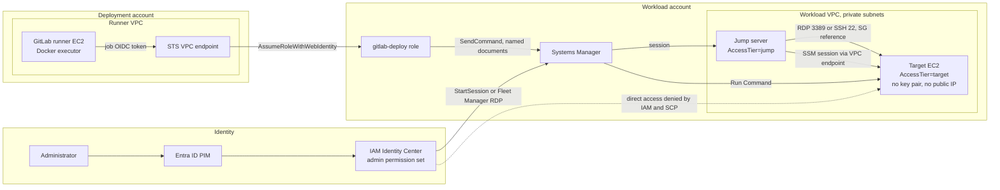

# Protecting EC2 Target Instances from Direct Access

Design summary: target EC2 instances are reachable only from the designated jump servers in their own account, or from the GitLab pipeline job execution environment. Every other path is closed.

Related: [jumphosts.md](jumphosts.md), [jumpserver.md](jumpserver.md).

---

## 1. Scope and requirements

- EC2 instances are created **without key pairs**.
- Each account has jump servers. Administrators reach them with SSM Session Manager (Linux) or Fleet Manager RDP (Windows), after activating access through Entra ID PIM.
- From a jump server, administrators connect to target instances by SSM session or RDP.
- The GitLab pipeline connects to target instances for deployment and configuration. Runners are EC2 instances with the Docker executor, in a VPC in a dedicated deployment account.
- **Goal:** nobody and nothing reaches a target instance except through a jump server or a pipeline job.

## 2. The key point

Security groups alone cannot meet the goal. SSM sessions and Run Command do not use an inbound network path (the SSM agent dials out), so any principal holding `ssm:StartSession` or `ssm:SendCommand` on a target can bypass the jump server entirely. The design therefore needs three layers: network, IAM, and SCP guardrails.

## 3. Access paths

Editable draw.io version of this diagram: [ec2-target-access-protection.drawio](ec2-target-access-protection.drawio).

## 4. Layer 1: Network (RDP, SSH, WinRM)

- Targets sit in private subnets with no public IP and no key pair.
- The target security group allows inbound 3389/22 **only from the jump server security group** in the same account (security group reference, not CIDR).
- No inbound rule exists for the pipeline. It uses SSM Run Command, so no network path is needed between the runner VPC and the workload VPCs.

## 5. Layer 2: IAM (SSM sessions and commands)

Instances are tagged `AccessTier=jump` or `AccessTier=target`. Policies use the `ssm:resourceTag/AccessTier` condition.

| Principal | Allowed |
|---|---|
| Admin permission set (activated via PIM) | `ssm:StartSession` and Fleet Manager RDP on `jump` instances only |
| Jump to target hop | See the two options below |
| `gitlab-deploy` role (one per workload account) | `ssm:SendCommand` with named documents on `target` instances only |

**Jump to target, two options:**

1. **Jump instance role** holds `ssm:StartSession` on `target` instances. Simple, but sessions are recorded as the instance role rather than the individual user.
2. **Administrator's own role** may start target sessions only when the request arrives through the account's SSM interface endpoint (`aws:SourceVpce`). The call must then originate inside the VPC, and per-user attribution is kept.

**Pipeline identity chain:**

- The GitLab job presents an OIDC ID token and calls `AssumeRoleWithWebIdentity` for `gitlab-deploy` in the target account.
- The role trust policy pins the token `sub` claim to a specific project and protected branch, so only that pipeline can deploy.
- The trust policy also requires `aws:SourceVpce` to be the STS endpoint in the runner VPC, so the role can only be assumed from the job execution environment.
- The runner's own instance role holds no deployment rights.

**Runner settings that protect this chain (Docker executor):**

- `privileged = false`, and the Docker socket is never mounted into jobs.
- Host networking is not allowed, and the IMDSv2 hop limit is 1, so job containers cannot read the instance role credentials.
- Deploy runners are registered as protected runners, usable only by protected branches and environments.

## 6. Layer 3: SCP guardrails

These stop layers 1 and 2 from being undone inside an account.

- Deny `ssm:StartSession` and `ssm:SendCommand` on `target` instances unless `aws:PrincipalArn` is the jump role, `gitlab-deploy`, or one of the platform service roles in section 7.
- Deny `ssm:CreateAssociation`, `ssm:UpdateAssociation` and `ssm:StartAutomationExecution` on `target` instances with the same exceptions. These run commands on an instance without a `SendCommand` call (see section 7).
- Deny the side doors: EC2 Instance Connect, EC2 serial console, and `ec2:GetPasswordData`.
- Deny `ec2:RunInstances` on resource `arn:aws:ec2:*:*:key-pair/*`, which blocks launching with any key pair.
- Deny changes to the `AccessTier` tag, the target security groups, and the exempt roles, except by the account provisioning role. Without this, an administrator could retag a target as a jump server or create a look-alike role.

## 7. Platform services (AWS Backup, Patch Manager, State Manager)

Some AWS services act on instances through Systems Manager. The SCP in section 6 affects them, so they need named exceptions. Each exception is limited to the SSM documents that service needs, so it cannot be used to run arbitrary commands.

| Service | Mechanism | Impact without an exception | Treatment |
|---|---|---|---|
| AWS Backup, EBS snapshot or AMI backups | EC2 snapshot and image APIs only | None | No exception needed |
| AWS Backup, Windows VSS (application-consistent) | Backup role calls `ssm:SendCommand` with `AWSEC2-CreateVssSnapshot` | `SendCommand` is denied. Backup falls back to a crash-consistent snapshot, so the failure is easy to miss | Exempt the Backup role, limited to `AWSEC2-CreateVssSnapshot` |
| AWS Backup, restore | Restore role launches an instance and may copy tags | Blocked if the tag guardrail denies setting `AccessTier` | Exempt the restore role from the tag guardrail |
| Patch Manager, maintenance window with a custom service role | Service role calls `ssm:SendCommand` with `AWS-RunPatchBaseline` | Patching is denied | Exempt the role, limited to `AWS-RunPatchBaseline` |
| Patch Manager, maintenance window with the Systems Manager service-linked role | Service-linked role | None. SCPs do not apply to service-linked roles | No exception needed |
| Patch Manager, Quick Setup patch policies | State Manager associations, plus Automation runbooks and Lambda functions under Quick Setup roles | Depends on the roles Quick Setup creates | Exempt the Quick Setup roles for patching documents only, then test against the SCP |
| State Manager associations | Runs documents on the instance without a `SendCommand` call | Not blocked by the `SendCommand` deny. This is a bypass of the access model | Deny `CreateAssociation` and `UpdateAssociation` except by the provisioning role (section 6) |
| Automation runbooks with `aws:runCommand` steps | Run under the caller or the automation assume role | Another bypass if left open | Deny `StartAutomationExecution` on targets except by named roles (section 6) |

**Rules for these roles:**

- Restrict each exempt role with a condition on `ssm:SendCommand` document ARNs, e.g. `arn:aws:ssm:*::document/AWSEC2-CreateVssSnapshot` for Backup and `arn:aws:ssm:*::document/AWS-RunPatchBaseline` for patching.
- Deny `iam:PassRole` for the automation and maintenance window service roles except by the provisioning role, so nobody else can attach them to a new task.
- Associations, maintenance windows and patch policies are created only by the provisioning pipeline, so they are code-reviewed like other changes.

## 8. Resulting access matrix

| Path to target | Outcome | Enforced by |
|---|---|---|
| Administrator, direct SSM session or RDP | Blocked | IAM, SCP, security group |
| Administrator, via jump server | Allowed | Security group reference, IAM |
| GitLab job, via `gitlab-deploy` | Allowed | OIDC trust policy, IAM |
| Any other role | Blocked | SCP |
| Any other network source | Blocked | Security group |
| SSH with key pair, Instance Connect, serial console | Blocked | No key pair, SCP |
| AWS Backup and Patch Manager service roles | Allowed, named documents only | SCP exception with document condition |
| New State Manager association or Automation run by an admin | Blocked | SCP |

## 9. Detection

- Session Manager logs go to S3 or CloudWatch Logs.
- CloudTrail alert on any `StartSession`, `SendCommand`, `CreateAssociation`, `UpdateAssociation` or `StartAutomationExecution` against a `target` instance from a principal other than the jump role, `gitlab-deploy`, the platform service roles, or the provisioning role.
- CloudTrail alert on changes to the `AccessTier` tag or the target security groups.
- Alert on AWS Backup jobs for Windows targets that complete without a VSS snapshot, since that failure falls back silently.

## 10. Open decisions

- Which jump-to-target option to use (section 5). Option 2 is preferred if per-user audit is required.
- Whether any workload needs direct network access from the pipeline (WinRM, SSH, Ansible). That would need Transit Gateway or peering from the runner VPC and a CIDR-based security group rule on targets, and it weakens the "no inbound path from outside the account" property.
- For self-managed GitLab, AWS must be able to reach the OIDC discovery and JWKS endpoints publicly for `AssumeRoleWithWebIdentity` to work.
