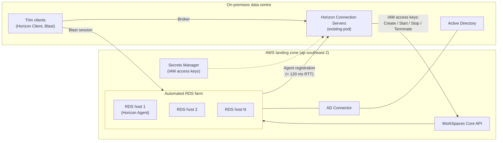

# Scaling Amazon WorkSpaces Core from an On-Premises Omnissa Horizon Pod

> **Context:** Migrated applications that need non-browser (thin-client) access are delivered today as Omnissa Horizon published applications. The plan is to extend the existing on-premises Horizon pod into the AWS landing zone, using Amazon WorkSpaces Core as a **capacity provider**.
>
> **Question:** How can WorkSpaces Core desktops and RDS hosts be scaled by a Horizon Connection Server hosted on-premises?
>
> *Researched: 23 Oct 2026, against Horizon 8 docs 2512 / 2609.*

---

## TL;DR

- The on-prem **Connection Server is the control plane**. It calls the WorkSpaces Core APIs to create, start, stop and terminate WorkSpaces, and keeps a pool or farm between the sizes you configure.
- Scaling is **schedule- and size-driven, not metric-driven**. You set maximums, spare/headroom and power schedules; Horizon provisions and powers machines on and off to match. There is no CPU- or session-based autoscaling.
- For **published apps**, the construct is an **automated RDS farm** on WorkSpaces Core (supported from Horizon **2506**). Desktop pools are for single-session desktops.
- An on-prem Connection Server authenticates to AWS with **IAM access keys**. A Connection Server in EC2 uses an instance profile.
- ⚠️ The docs **contradict themselves** on whether an on-prem Connection Server is supported for *automated* WorkSpaces Core pools and farms. **Get written confirmation from Omnissa** before committing. Fallback: Cloud Pod Architecture (CPA) with a second pod in AWS.

---

## Architecture



---

## 1. How the on-prem Connection Server controls WorkSpaces Core

### 1.1 Register WorkSpaces Core as a capacity provider

In Horizon Console go to **Settings → Servers → Capacity Providers → Add**:

| Field | Value |
|---|---|
| Provider Type | Amazon WorkSpaces Core |
| Display Name | e.g. `aws-apse2-wscore` |
| Region | e.g. Asia Pacific (Sydney) `ap-southeast-2` |
| Use IAM Access Keys | **Checked**, because the Connection Server is outside EC2 |
| AWS Access Key ID / Secret Access Key | From the dedicated IAM user (below) |

The IAM role and permissions must exist **before** the provider is added.

### 1.2 IAM permissions (these API calls do the scaling)

| Connection Server location | Authentication |
|---|---|
| In Amazon EC2 | IAM role attached via instance profile |
| **On-premises or in another cloud** | **IAM user Access Key ID + Secret Access Key** |

Attach to the IAM principal:

- `AmazonSSMDirectoryServiceAccess` (AWS managed)
- `AmazonSSMManagedInstanceCore` (AWS managed)
- Inline policy `Omnissa-CS-admin`:

```json
{
  "Version": "2012-10-17",
  "Statement": [
    {
      "Sid": "AmazonWorkSpacesAdmin",
      "Effect": "Allow",
      "Action": [
        "kms:DescribeKey",
        "kms:ListAliases",
        "kms:ListKeys",
        "workspaces:CreateTags",
        "workspaces:CreateWorkspaceImage",
        "workspaces:CreateWorkspaces",
        "workspaces:CreateStandbyWorkspaces",
        "workspaces:DeleteTags",
        "workspaces:DeregisterWorkspaceDirectory",
        "workspaces:DescribeTags",
        "workspaces:DescribeWorkspaceBundles",
        "workspaces:DescribeWorkspaceDirectories",
        "workspaces:DescribeWorkspaces",
        "workspaces:DescribeWorkspacesConnectionStatus",
        "workspaces:ModifyCertificateBasedAuthProperties",
        "workspaces:ModifySamlProperties",
        "workspaces:ModifyWorkspaceCreationProperties",
        "workspaces:ModifyWorkspaceProperties",
        "workspaces:RebootWorkspaces",
        "workspaces:RebuildWorkspaces",
        "workspaces:RegisterWorkspaceDirectory",
        "workspaces:RestoreWorkspace",
        "workspaces:StartWorkspaces",
        "workspaces:StopWorkspaces",
        "workspaces:TerminateWorkspaces",
        "workspaces:UpdateWorkspaceBundle",
        "workspaces:DescribeWorkspaceImages"
      ],
      "Resource": "*"
    }
  ]
}
```

For encrypted WorkSpaces, also add the IAM principal to the KMS key administrators.

> **Operational note:** Long-lived keys on an on-prem server are a risk. Store them in Secrets Manager or the enterprise vault, scope the IAM user to this policy only, and write a key-rotation runbook (rotation means updating the capacity provider in Horizon Console).

### 1.3 Agents register back to the pod

WorkSpaces Core instances run the Horizon Agent and register with the Connection Server as *non-vSphere* machines. Brokering then works like any other pool or farm.

**Latency requirement:** Connection Server → agent round trip must be **under 120 ms** when extending an existing private-datacentre pod. Brisbane ↔ `ap-southeast-2` over Direct Connect or site-to-site VPN should be inside this, but measure it.

---

## 2. Scaling controls

### 2.1 Automated desktop pools (single-session desktops)

| Setting | What it does |
|---|---|
| **Provision machines: On demand** | Creates a *minimum* number at pool creation, then adds machines as users connect for the first time or are assigned |
| **Provision machines: All up-front** | Builds every machine up to *Maximum machines* immediately |
| **Maximum machines** | Pool ceiling |
| **Spare powered-on machines** | Warm headroom kept on for new users |
| **Remote Machine Power Policy: Always Powered On** | Monthly billing |
| **Remote Machine Power Policy: Power Optimized** | Hourly billing, with a power-off schedule by day and time |
| **Spare = 0** (Power Optimized only) | All machines provisioned up-front and stopped; each is started on user request. Lowest idle cost, but a slow first logon |
| **Delete machine on logoff** | Destroys the desktop at logoff (not for Dedicated + Always On monthly) |
| **Stop provisioning on error** | Stops a bad bundle failing across the whole pool |
| **Enable provisioning** (toggle) | Freezes pool size, e.g. during bundle changes |
| **Naming pattern** | Prefix plus a unique number. Variables are not supported for WorkSpaces Core |

Supported OS: Windows 10/11, or Windows Server 2019/2022 public BYOP bundles (single-session).

### 2.2 Automated RDS farms (published applications), the relevant model here

- Supported on WorkSpaces Core from **Horizon 2506**.
- RDS hosts are built from AWS **public BYOP bundles for Windows Server 2019 / 2022**, customised into a golden pattern.
- Scaling is at the **RDS-host level**. Horizon provisions more hosts from the bundle up to the farm maximum, and distributes sessions across hosts using standard Horizon RDS load balancing.
- Farm maintenance is scheduled through Horizon ("Schedule Maintenance for an Automated RDSH Farm in Amazon WorkSpaces Core").

> **To verify:** The exact WorkSpaces Core field names in the farm wizard (max hosts, sessions per host, power schedule) were not confirmed in this research. Check them against *Worksheet for Creating an Automated Farm in Horizon* for your Horizon version.
>
> The Tech Zone feature table predates farm support and still says **VM hosted apps** are not available on automated WorkSpaces Core pools. **Use RDS farms for published apps**, not app-on-desktop pools.

---

## 3. Constraints and risks

| # | Item | Impact / action |
|---|---|---|
| 1 | **Docs conflict on on-prem Connection Server.** Prerequisites say the deployment must run on EC2 with the Connection Server in EC2, but the IAM section documents access keys for on-prem Connection Servers. | Get written confirmation from Omnissa for *automated farms* at your Horizon version |
| 2 | **Blast Extreme only** for automated pools and farms on WorkSpaces Core | Validate thin-client firmware and Horizon Client support Blast. PCoIP-only devices won't work |
| 3 | No instant clones | Full clones only. Updates are by bundle rebuild |
| 4 | No Linux on WorkSpaces Core | Use EC2 + Remote Agent for Linux workloads |
| 5 | Directory | Use **AD Connector**. Simple AD is **not supported** |
| 6 | **Do not enable Maintenance Mode** on the WorkSpaces directory | It interferes with Horizon lifecycle management |
| 7 | Licensing | **BYOL must be enabled** on the AWS account. RDS CALs are required for farm hosts |
| 8 | Static IAM keys | Secrets handling, rotation, least privilege, CloudTrail alerting on the IAM user |
| 9 | WAN dependency | Brokering and agent heartbeats cross the DX/VPN. Design for link redundancy |

### Fallback: hybrid Cloud Pod Architecture

If (1) comes back unsupported, use the documented **Option 2: hybrid CPA**:

- Keep the on-prem pod.
- Deploy a **second Horizon pod in AWS** (Connection Servers on EC2, using an instance profile instead of long-lived keys).
- Federate both pods with **CPA** for a single global entitlement.
- This also removes the 120 ms WAN dependency for the AWS-hosted capacity.

---

## 4. Recommended design for the landing zone

1. **Capacity provider:** one WorkSpaces Core provider in `ap-southeast-2`, using a dedicated IAM user with only the documented policy. Keys go in Secrets Manager with a rotation runbook.
2. **Directory:** AD Connector into corporate AD, with Maintenance Mode **off**.
3. **Golden pattern:** Windows Server 2022 BYOP bundle → install the migrated COTS apps → install the Horizon Agent (RDS) → *Set Gold Image* in Horizon → create the custom image and bundle.
4. **Farm:** automated RDS farm from that bundle.
   - **Max hosts** = ⌈peak concurrent sessions ÷ sessions per host⌉ + 1 (N+1)
   - **Power Optimized** schedule so hosts stop outside business hours
5. **Application pools:** publish the apps on the farm. Use Connection Server tags to route thin-client users to the right brokers.
6. **Pre-go-live checks:** Connection Server→agent RTT under 120 ms; Blast on thin clients; Omnissa support confirmation; RDS CAL coverage.

---

## Sources

- [Deploying Omnissa Horizon with Amazon EC2 and Amazon WorkSpaces – Tech Zone](https://techzone.omnissa.com/resource/deploying-omnissa-horizon-amazon-ec2-and-amazon-workspaces#choosing-between-horizon-on-amazon-ec2-and-amazon-workspaces-core)
- [Desktops and Applications in Horizon 8 (2512)](https://docs.omnissa.com/Desktops-and-Applications-in-Horizon-V2512/DesktopsandApplicationsinHorizon8)
- [WorkSpaces Core – Creating and Preparing Sources for Automated Desktop Pools (2609)](https://docs.omnissa.com/Desktops-and-Applications-in-Horizon-V2609/AmazonWSCore-CreatingForPoolProvisioning)
- [WorkSpaces Core – Creating and Preparing Sources for Automated Farms (2609)](https://docs.omnissa.com/Desktops-and-Applications-in-Horizon-V2609/AmazonWSCore-CreatingForAutomatedFarms)
- [WorkSpaces Core – Add a Capacity Provider in Horizon Console (2609)](https://docs.omnissa.com/Desktops-and-Applications-in-Horizon-V2609/AmazonWSCore-AddasCapacityProvider)
- [WorkSpaces Core – Create the Desktop OS Golden Pattern (2512)](https://docs.omnissa.com/bundle/Desktops-and-Applications-in-HorizonV2512/page/AmazonWSCore_CreateDesktopOSGoldenPattern.html)
- [WorkSpaces Core – Create an Automated Full-Clone Desktop Pool (2512)](https://docs.omnissa.com/bundle/Desktops-and-Applications-in-HorizonV2512/page/AWS-Cores-CreateanAutomatedFullCloneDesktopPool.html)
- [WorkSpaces Core – Worksheet for Creating an Automated Full-Clone Desktop Pool (2512)](https://docs.omnissa.com/bundle/Desktops-and-Applications-in-HorizonV2512/page/AWSCore-WorksheetAutoFullCloneDesktopPool.html)
