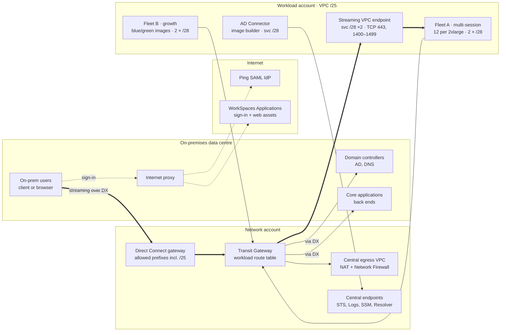
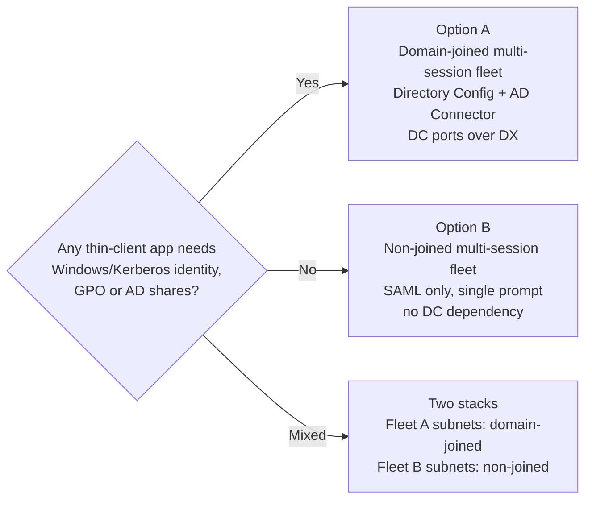

# WorkSpaces Applications Hybrid Architecture

Oct 26, 2026 · @Joshua

## Summary

Run the thin-client application front ends on Amazon WorkSpaces Applications (formerly AppStream 2.0) multi-session Windows fleets in a dedicated workload account in ap-southeast-2, streamed privately to on-premises users over Direct Connect. For 250 named users and 175 peak concurrent sessions the indicative run cost is about **US$6,000 a month (≈US$24 per named user)**, dominated by instance-hours and the Microsoft RDS SAL user fee.

Key design decisions:

1. **Multi-session fleets are mandatory, not optional.** A /28 gives 11 usable IPs and each fleet instance takes one ENI, so a fleet spread over two AZs tops out at 22 instances. Packing 12 sessions on a stream.standard.2xlarge lifts one fleet to roughly 220–260 sessions.
2. **Streaming traffic stays private.** A `com.amazonaws.ap-southeast-2.appstream.streaming` interface endpoint carries pixels, input, clipboard, USB and printing over Transit Gateway and Direct Connect. Sign-in and web assets still need internet, which users reach through the existing on-premises proxy.
3. **The streaming endpoint lives in the workload VPC**, a deliberate exception to the central-endpoint pattern. All other AWS service endpoints (STS, S3 interface, CloudWatch, SSM, AppStream API) stay centralised in the network account.
4. **Identity = SAML 2.0 sign-in with AD accounts.** Users sign in with their AD account through a SAML identity provider (Ping or AD FS). Whether fleets also domain-join depends on whether the thin-client apps need Windows/Kerberos identity, which is an open item; Option A (domain-joined) and Option B (SAML only) under [Architecture options](#architecture-options-ad-dependent-or-not) cover both answers.
5. **Scale on user sessions.** Scheduled scaling pre-warms capacity before 07:00, target tracking on capacity utilisation absorbs the peak, and session limits let instances drain for scale-in.

## Context and assumptions

Thin-client applications are the presentation tier (for example Oracle Forms, Java Swing or other fat-client front ends) that talk chatty protocols to core applications. Streaming them from AWS keeps the client next to its back end and sends only pixels to the user.

| Area | Assumption |
| --- | --- |
| Region and AZs | ap-southeast-2 only, two AZs (apse2-az1, apse2-az2) |
| Landing zone | Central ingress/egress and centralised interface endpoints in the network account; Transit Gateway hub |
| Hybrid link | Existing Direct Connect from the on-prem DC, terminating on a Direct Connect gateway associated to the TGW |
| Workload VPC | One /25 (128 addresses) per account, carved into /28 subnets (16 addresses, 11 usable after AWS reserves 5) |
| Users | Connect only from the on-prem network; 250 named, 175 peak concurrent, 07:00–19:00 AEST, 22 working days |
| Directory | On-prem AD is the user and computer domain; AD Connector stands in for it in AWS |
| Identity provider | PingFederate / PingOne issuing SAML 2.0 (already widely used) |
| Core applications | On-prem or in AWS workload VPCs reachable over the TGW |
| Prices | USD, on-demand, before GST; Sydney instance rates are indicative and must be checked in the AWS Pricing Calculator |

## Architecture overview

Pixels stay on Direct Connect; only sign-in uses the internet.



Users stream from the workload VPC through the DX gateway, Transit Gateway and the local streaming endpoint; fleet traffic to domain controllers and core applications returns to on-prem over the same TGW and DX, and internet-bound traffic leaves through the central egress VPC.

## Network design

The /25 splits into exactly eight /28s: two fleet pairs, a shared-services pair and a TGW-attachment pair, one of each per AZ. Each fleet instance consumes one ENI and WorkSpaces Applications creates as many ENIs as the fleet's maximum capacity, so **IP addresses, not compute, set the ceiling**. A fleet uses one subnet per AZ; AWS warns that a second subnet in the same AZ is not used, so growth comes from a second fleet on the second subnet pair.

Example addressing (replace 10.20.4.0/25 with the IPAM allocation):

| Subnet | CIDR | AZ | Usable IPs | Holds |
| --- | --- | --- | --- | --- |
| fleet-a-az1 | 10.20.4.0/28 | az1 | 11 | Fleet A instances |
| fleet-a-az2 | 10.20.4.16/28 | az2 | 11 | Fleet A instances |
| fleet-b-az1 | 10.20.4.32/28 | az1 | 11 | Fleet B (growth, or blue/green image cut-over) |
| fleet-b-az2 | 10.20.4.48/28 | az2 | 11 | Fleet B |
| svc-az1 | 10.20.4.64/28 | az1 | 11 | Streaming VPC endpoint ENI, AD Connector, image builder, app block builder |
| svc-az2 | 10.20.4.80/28 | az2 | 11 | Streaming VPC endpoint ENI, AD Connector |
| tgw-az1 | 10.20.4.96/28 | az1 | 11 | Transit Gateway attachment ENI |
| tgw-az2 | 10.20.4.112/28 | az2 | 11 | Transit Gateway attachment ENI |

Per fleet the hard ceiling is 22 instances; with 12 sessions per instance that is 264 sessions, and 132 if one AZ is lost. Fleet A plus Fleet B gives 44 instances and about 528 sessions.

**Routing**

- Fleet and service subnets: on-prem prefixes and 0.0.0.0/0 → TGW. No IGW or NAT in the workload VPC.
- TGW workload route table: default → central egress VPC (NAT + AWS Network Firewall); on-prem → Direct Connect gateway attachment; other workload VPCs as the landing zone allows.
- Direct Connect gateway: add the /25 (or the workload summary it sits in) to the allowed prefixes so it is advertised to the on-prem routers.
- On-prem: route the /25 towards the Direct Connect routers; client-to-endpoint traffic must not hairpin through the internet proxy.

**Endpoints**

- `com.amazonaws.ap-southeast-2.appstream.streaming` interface endpoint in svc-az1 and svc-az2, private DNS on, referenced on each stack's VPC Endpoints tab. AWS allows the endpoint in a different VPC from the fleet, but keeping it local avoids a cross-account dependency between the stack and the network account and keeps per-user pixel traffic off the shared endpoint VPC.
- Everything else (STS, CloudWatch Logs, SSM, KMS, S3 interface, AppStream API `appstream2`) uses the central endpoints through the shared Route 53 private hosted zones. Add an S3 gateway endpoint locally if home folders and app settings persistence are used, as it is free.
- Once a stack has a streaming endpoint, users can no longer stream over the internet endpoint, which suits an on-prem-only population.
- The streaming endpoint does not support Windows Desktop OS fleets (for example Windows 11), so images are built on Windows Server 2022.

**DNS**

- Route 53 Resolver outbound rule (network account, shared through RAM) forwards the corporate AD domain to on-prem DNS so fleets can locate domain controllers.
- On-prem DNS resolves the endpoint-specific name `<vpce-id>.streaming.appstream.ap-southeast-2.vpce.amazonaws.com` to its private IPs; if public resolution is blocked, conditionally forward `vpce.amazonaws.com` to the Route 53 Resolver inbound endpoint in the network account.
- If users go through a proxy, exclude that name from proxy caching and allow it through.

**Internet that is still needed**

Only the streaming traffic can move to a private endpoint. The streaming interface endpoint replaces just the session gateway domain (`*.amazonappstream.com`); getting a user into a session still needs AWS's public sign-in and portal services, which have no PrivateLink endpoint. This is user devices reaching a few AWS-owned names over HTTPS at sign-in, not general browsing, and fleet instances do not need it.

| Purpose | Domain | Private endpoint? |
| --- | --- | --- |
| Portal and user authentication | `*.appstream2.ap-southeast-2.aws.amazon.com` | No |
| SAML sign-in | `signin.aws.amazon.com`, `ap-southeast-2.signin.aws.amazon.com` | No |
| SAML relay state | `appstream2.euc-sso.ap-southeast-2.aws.amazon.com` | No |
| Identity provider | PingOne (SaaS) needs internet; PingFederate or AD FS on-prem does not | n/a |
| Session gateway | `*.amazonappstream.com` (incl. `*.streaming.` and `*.dcv-streaming.ap-southeast-2.appstream2.amazonappstream.com`) | Yes: replaced by `<vpce-id>.streaming.appstream.ap-southeast-2.vpce.amazonaws.com` |

Domains from AWS's [allowed domains list](https://docs.aws.amazon.com/appstream2/latest/developerguide/allowed-domains.html).

**Sign-in path options**

| Option | How | Trade-off |
| --- | --- | --- |
| Direct Connect public VIF (recommended for a fully private path) | Add a public virtual interface on the existing DX; on-prem routers prefer the AWS public prefixes it advertises for the domains above | Sign-in rides the DX circuit, not the ISP; needs public IPs for the VIF and route filtering so only the intended AWS prefixes are preferred |
| Allow-list proxy | Keep the on-prem internet proxy; allow only the domains above, caching off for the authentication domains | Simplest; sign-in depends on the internet link and proxy |
| Custom portal + private API endpoint | Portal calls `CreateStreamingURL` through `com.amazonaws.ap-southeast-2.appstream.api` (central endpoint) | Removes SAML from the path, but the browser still loads the session from the public portal domain; narrows, does not remove, the dependency |

The closest to fully private is a DX public VIF with an on-prem identity provider (PingFederate or AD FS); the AWS public endpoints are still in the path, but none of the traffic crosses the internet.

## Identity and directory

Users authenticate to Ping with SAML 2.0, land on a stack through an IAM role and relay state, and get a domain-joined Windows session in the on-prem AD domain.

1. User opens the Ping application tile from the corporate network.
2. Ping issues a SAML assertion; AWS STS exchanges it for the role tied to the stack (`appstream:Stream` scoped to the stack ARN).
3. WorkSpaces Applications assigns a session on a multi-session fleet instance and the client connects to the streaming endpoint over Direct Connect.
4. The instance is already joined to the on-prem domain (Directory Config: domain FQDN, service account, target OU), so the user gets their AD profile, GPOs and Kerberos tickets to core applications.
5. With certificate-based authentication (CBA), the session logs on with a short-lived certificate from AWS Private CA; without it the user types the AD password a second time.

**Role of AD Connector.** Per the brief, AD Connector sits in svc-az1/svc-az2 as the AWS-side stand-in for the on-prem domain: its two IPs give the VPC a local directory and DNS proxy and it serves any other AWS directory consumers (WorkSpaces Personal, IAM Identity Center). WorkSpaces Applications itself domain-joins through its Directory Config, and the Kerberos/LDAP traffic still lands on on-prem domain controllers over Direct Connect, so a DX outage stops new logons either way.

**AD prerequisites**

- A dedicated OU for streaming computer objects, with a service account delegated to create and delete computer objects there.
- Fleet SG and on-prem firewalls open from the fleet subnets to the DCs: DNS 53, Kerberos 88/464, LDAP 389/636, SMB 445, RPC 135 and 49152–65535, NTP 123, Global Catalog 3268/3269.
- If users and computers are in different domains, only two-way trusts are supported.
- Elastic fleets cannot domain-join, which rules them out for this design.

**Resilience option.** If AD availability during a DX outage matters, add two self-managed domain controllers on EC2 in the shared-services account, one per AZ, in their own AD site so logons survive a DX outage (AWS Managed Microsoft AD would be a separate domain needing a trust, not extra DCs).

## Architecture options: AD-dependent or not

Pick **Option A** if any thin-client app needs Windows identity inside the session; otherwise pick **Option B**, which is simpler, slightly cheaper and gives single sign-on by default. Both keep the same VPC layout, streaming endpoint, multi-session fleet and scaling; only the identity and directory layer changes. SAML 2.0 is the front door in both, and AD stays the user store behind the identity provider.

The deciding test, per application: does it use integrated Windows authentication or Kerberos (SQL Server, IIS, SMB shares), Group Policy, AD-secured file shares or printers, or need the AD username in OS-level audit? Any yes → Option A.

| Aspect | Option A: domain-joined fleet | Option B: SAML only, no domain join |
| --- | --- | --- |
| When it fits | Apps use Windows/Kerberos auth, GPOs, AD-secured shares or printers | Apps have their own login (database or app credentials, web SAML) |
| User sign-in | SAML IdP (Ping or AD FS) checks the AD password | Same |
| Windows session identity | User's own AD account | Generic local account (`PhotonUser`); identity known to the service from SAML |
| Password prompts | Two, or one with certificate-based authentication (AWS Private CA) | One |
| Directory components in AWS | Directory Config, computer-object OU and service account; AD Connector per the brief | None |
| Network to domain controllers | Fleet subnets → on-prem DCs over DX (DNS, Kerberos, LDAP, SMB, RPC) | Not needed; only IdP and core-app traffic |
| DX outage | Stops new logons and AD-integrated apps | Stops core apps that live on-prem; nothing extra from AD |
| Fleet types | Always-On or On-Demand (Elastic cannot domain-join) | Also Elastic, but single-session only, so multi-session still wins on /28 subnets |
| User profile and data | Roaming via AD, plus S3 home folders | S3 home folders and app settings persistence |
| Image build | AD join, GPO testing, OU lifecycle | Plain image; fewer moving parts |
| Monthly cost delta (250 users) | Base case US$5,990; +~US$50 if Private CA is added for SSO | About US$5,946 (no AD Connector) |
| Main risk | AD path over DX becomes part of every logon | An app later found to need Kerberos forces a rebuild as Option A |



Option B removes the AD Connector from svc-az1/svc-az2 and the DC rules from the fleet security group; nothing else in the network design changes. If the answer is mixed, run two stacks: a domain-joined fleet on the Fleet A subnets for AD-dependent apps and a non-joined fleet on the Fleet B subnets for the rest, each with its own SAML role.

## Fleet design and scaling

Use a Windows Server 2022, domain-joined, **On-Demand multi-session** fleet on stream.standard.2xlarge (8 vCPU, 32 GiB) with a maximum of 12 sessions per instance, scaled on user sessions. For multi-session fleets, minimum, maximum and desired capacity are all expressed in user sessions and the service works out how many instances to run.

**Sizing rule**

```math
\text{instances} = \left\lceil \frac{\text{peak sessions} \times (1 + \text{buffer})}{\text{sessions per instance} \times \text{packing efficiency}} \right\rceil
```

With 175 peak sessions, a 10% buffer, 12 sessions per instance and 85% packing (sessions do not fill every instance evenly), the fleet peaks at 19 instances, inside the 22-instance IP ceiling.

| Concurrent sessions | Instance type × sessions | Peak instances | Fits subnets? |
| --- | --- | --- | --- |
| 70 | 2xlarge × 12 | 8 | Fleet A only |
| 175 | 2xlarge × 12 | 19 | Fleet A only, 3 spare |
| 175 | xlarge × 6 | 38 | No: needs Fleet A + B |
| 350 | 2xlarge × 12 | 38 | Fleet A + B |
| 500+ | 2xlarge × 12 | 54+ | No: a second /25 or a larger CIDR |

Validate 12 sessions per instance with a load test of the real thin-client mix (CPU, RAM per session, logon storm) on the image builder before committing; the setting can be changed after the fleet is provisioned.

**Fleet settings**

| Setting | Value | Why |
| --- | --- | --- |
| Fleet type | On-Demand | Idle instances bill only the stopped fee; 1–2 minute connect delay is absorbed by pre-warming. Switch to Always-On if users will not accept that delay. |
| Max sessions per instance | 12 | Light thin-client apps; allowed range 2–50 |
| Min user sessions | 12 off-hours, 132 from 06:45 weekdays | One warm instance overnight; 11 instances before the 07:00–09:00 ramp |
| Max user sessions | 240 | Keeps the fleet under the 22-ENI ceiling with headroom |
| Max session duration | 12 h | Forces a daily recycle so instances can drain |
| Disconnect timeout | 15 min | Reconnects within this window return to the same session |
| Idle disconnect | 30 min | Frees sessions held by idle users |
| Subnets | fleet-a-az1, fleet-a-az2 | One per AZ |

**Scaling policies (Application Auto Scaling)**

1. **Scheduled:** 06:45 AEST weekdays raise minimum to 132 sessions; 19:30 drop to 12; weekends minimum 12.
2. **Target tracking:** hold `CapacityUtilization` at 75%, scaling in user sessions.
3. **Step scale-out safety net:** if `InsufficientCapacityError` > 0, add 24 sessions (2 instances); if `AvailableUserSessionCapacity` < 24, add 24.
4. **Scale-in:** step down 12 sessions when `CapacityUtilization` < 40% for 15 minutes. An instance with live sessions is not taken away mid-session, so scale-in relies on the session-duration and idle limits above to drain instances.

**Image lifecycle**

Build on a stream.standard.2xlarge image builder with the thin-client apps, AD join and the WorkSpaces Applications agent; share the image only to this account. Roll out monthly patches by building a new image, pointing Fleet B at it during the week, then moving the stack association after hours; this blue/green cut-over is the second reason for the Fleet B subnet pair.

## Security controls

Streaming traffic never leaves private addressing, fleet instances have no inbound path from users, and all outbound internet goes through the central egress inspection.

| Control | Rule |
| --- | --- |
| Streaming endpoint SG | Inbound TCP 443 and TCP 1400–1499 from on-prem client CIDRs only |
| svc subnet NACL | Outbound TCP 1024–65535 to on-prem client CIDRs |
| Fleet SG | Outbound to DC ports (Identity section), core app ports, TCP 443 to central endpoints and egress; no inbound rules |
| Internet egress | Default route to TGW → central egress VPC, AWS Network Firewall domain allow-list (licence servers, app update sites only) |
| Stack data controls | Clipboard, file transfer and printing set per stack: copy out of the session and file download off unless a role needs them |
| IAM | SAML role per stack, `appstream:Stream` limited to that stack; fleet IAM role only for S3 home folders and CloudWatch |
| Encryption | TLS on the streaming path; S3 home folders encrypted with a customer-managed KMS key through the central KMS endpoint |
| Logging | CloudTrail (org trail), session usage reports to S3, fleet metrics and the Windows event logs to CloudWatch |
| Patching | Monthly image rebuild with the managed image updates feature; stopped image builders between builds |

## Costing

The base case costs about **US$5,990 a month: US$24 per named user or US$0.17 per user-hour**. Fleet instance-hours (65%) and the multi-session RDS SAL fee (27%) are 92% of the bill; networking adds about 7%.

Demand profile used: sessions ramp from 60 at 07:00 to 175 between 09:00 and 15:00, fall to 25 by 18:00, and are zero overnight. That is 1,590 user-hours a weekday, 34,980 a month, and 3,872 instance-hours on 22 working days.

| Line item | Rate used (Sydney, USD) | Quantity / month | US$ / month |
| --- | --- | --- | --- |
| Fleet instances, stream.standard.2xlarge Windows | 1.00 per instance-hour (indicative) | 3,872 instance-hours | 3,872 |
| RDS SAL user fee, multi-session | 6.42 per user | 250 users | 1,605 |
| Direct Connect data transfer out | 0.042 per GB (indicative) | 4,460 GB down | 187 |
| Transit Gateway attachment + data | 0.07 per hour + 0.02 per GB | 730 h, 5,250 GB | 156 |
| Streaming VPC endpoint | 0.013 per AZ-hour + 0.01 per GB | 2 AZ, 5,250 GB | 71 |
| AD Connector, small | 0.06 per hour (indicative) | 730 h | 44 |
| Image builder, stream.standard.2xlarge | 1.00 per hour | 20 h | 20 |
| CloudWatch logs and metrics | estimate | — | 15 |
| Stopped-instance fee | 0.03 per instance-hour (indicative) | 1 warm instance off-hours | 14 |
| S3 home folders | 0.025 per GB-month | 250 GB | 6 |
| **Total** | | | **5,990** |

Network volume assumes 150 MB per user-hour for thin-client screens (mostly static forms) and 85% of it downstream; video, CAD or heavy scrolling can be several times that. The instance rate already covers streaming-protocol traffic inside AWS, but the endpoint, TGW and DX charges above still apply. The existing DX port and the central egress/firewall are excluded as shared landing-zone costs.

**Scenarios** (same profile scaled; per-user cost is flat because the SAL fee and instance-hours both scale with users)

| Named users | Peak sessions | Peak instances | Fleets needed | US$ / month | US$ / named user |
| --- | --- | --- | --- | --- | --- |
| 100 | 70 | 8 | A | 2,490 | 24.94 |
| 250 | 175 | 19 | A | 5,990 | 23.96 |
| 500 | 350 | 38 | A + B | 11,820 | 23.64 |

**Levers that move the number**

- **Sessions per instance** is the biggest dial: 15 instead of 12 cuts instance cost by about 20%, if the load test allows.
- **Shorter day:** dropping the 18:00 hour saves about US$66 a month and the 17:00 hour about US$154 at 250 users.
- **BYOL RDS CALs** under License Mobility remove the US$6.42 per-user fee (US$1,605 a month here).
- **Always-On instead of On-Demand** adds the cost of every pre-warmed idle instance; only use it where instant connect is required.
- **Certificate-based auth** adds AWS Private CA in short-lived certificate mode (roughly US$50 a month), worth it for single sign-on.
- WorkSpaces Applications is not covered by EC2 Savings Plans, so there is no commitment discount on instance-hours.

Indicative rates were estimated from the published us-east-1 rates; confirm Sydney rates in the [AWS Pricing Calculator](https://calculator.aws/#/createCalculator/amazonAppStream) or with the [WorkSpaces Applications pricing tool](https://aws.amazon.com/workspaces/applications/pricing/) before the business case.

## Risks and open items

| Risk | Impact | Mitigation |
| --- | --- | --- |
| Application dependence on AD unconfirmed | Decides Option A or B: domain join, AD Connector, DC firewall rules and the DX dependency for logons | Inventory each thin-client app's authentication (Windows/Kerberos, GPO, AD shares or printers vs own login) before the build |
| /28 subnets cap each fleet at 22 instances | Insufficient-capacity errors at peak; one AZ loss halves capacity to 132 sessions | Multi-session at 12 per instance, Fleet B pair, request a larger VPC CIDR before passing ~350 concurrent |
| Direct Connect is a single path | Users and AD logons both stop if DX fails | Confirm DX resilience model (two connections, two locations) or a Site-to-Site VPN backup on the TGW |
| Sign-in depends on internet | On-prem proxy or identity-provider outage blocks new sessions while streaming is private | Allow-list authentication domains, monitor the proxy path |
| Sessions per instance unproven | Overpacking degrades the app; underpacking breaks the IP ceiling and the cost case | Load test on the image builder before production |
| Indicative Sydney rates | Cost estimate off by the rate error | Re-run the model with Pricing Calculator rates |
| Cross-account streaming endpoint unvalidated | Central placement may not be supported for a stack in another account | Keep the local endpoint; raise with the AWS account team if central placement is mandated |

Next steps:

- [ ] Confirm whether any thin-client app depends on AD, and choose Option A or B
- [ ] Choose the SAML identity provider (Ping or AD FS)
- [ ] Choose the sign-in path: Direct Connect public VIF or allow-list proxy
- [ ] Confirm user numbers, concurrency curve and the thin-client application list
- [ ] Load test sessions per instance on stream.standard.2xlarge
- [ ] Raise WorkSpaces Applications instance quotas and confirm the ENI quota in the workload account
- [ ] Agree the DX allowed-prefix change and the on-prem DNS approach with the network team
- [ ] Decide on certificate-based authentication (AWS Private CA) for single sign-on (Option A only)
- [ ] Re-cost with confirmed Sydney rates

## Sources

- [Amazon WorkSpaces Applications pricing](https://aws.amazon.com/workspaces/applications/pricing/) — fleet billing models, RDS SAL fees, multi-session billing
- [Creating and streaming from interface VPC endpoints](https://docs.aws.amazon.com/appstream2/latest/developerguide/creating-streaming-from-interface-vpc-endpoints.html) — service name, ports, internet dependency, Windows Desktop OS limitation
- [Allowed domains](https://docs.aws.amazon.com/appstream2/latest/developerguide/allowed-domains.html) — domains user devices must reach; what a VPC endpoint replaces
- [VPC setup recommendations](https://docs.aws.amazon.com/appstream2/latest/developerguide/vpc-setup-recommendations.html) — ENIs per fleet, one subnet per AZ
- [Configure a VPC for WorkSpaces Applications](https://docs.aws.amazon.com/appstream2/latest/developerguide/appstream-vpc.html) — two subnets in different AZs for fleets
- [Fleet Auto Scaling concepts](https://docs.aws.amazon.com/appstream2/latest/developerguide/autoscaling-concepts.md) — capacity in user sessions for multi-session fleets
- [Getting started: maximum sessions per instance](https://docs.aws.amazon.com/appstream2/latest/developerguide/getting-started.html) — range 2–50
- [Using Active Directory with WorkSpaces Applications](https://docs.aws.amazon.com/appstream2/latest/developerguide/active-directory.html) — on-prem domain join, two-way trusts, Elastic fleets cannot join
- [Scaling Optimizer Tool](https://aws.amazon.com/blogs/desktop-and-application-streaming/optimize-amazon-workspaces-applications-fleet-capacity-with-the-scaling-optimizer-tool) — sizing scaling policies from hourly usage
- [AD Connector pricing](https://www.aws.eu/directoryservice/other-directories-pricing/) — billed per directory-hour by size
